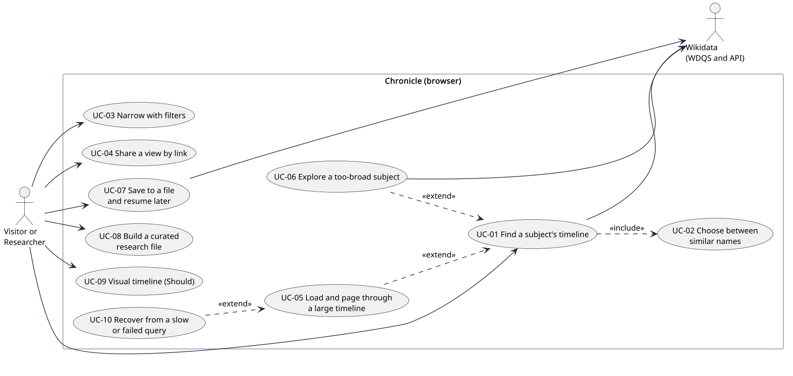
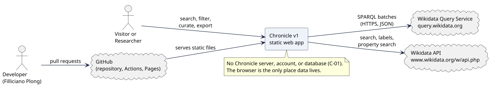
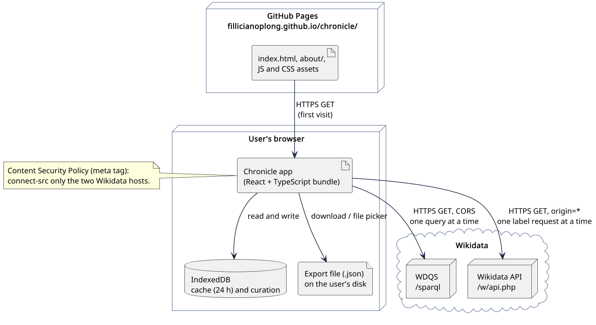
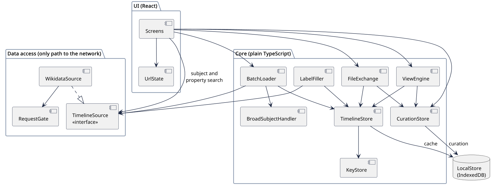
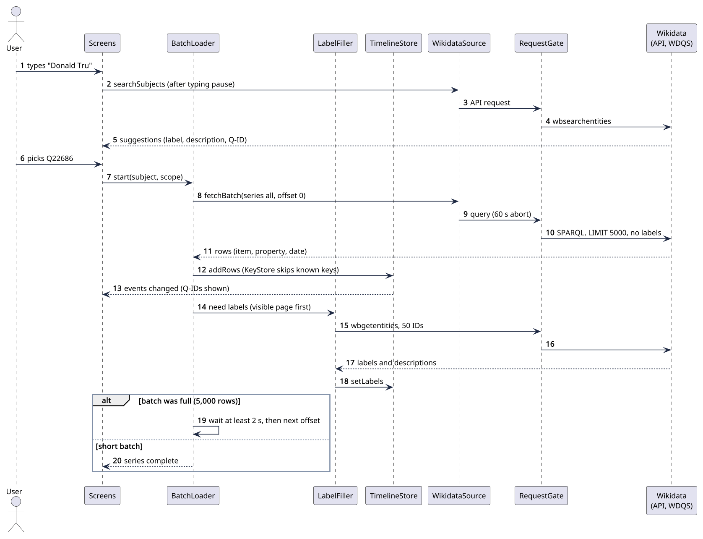
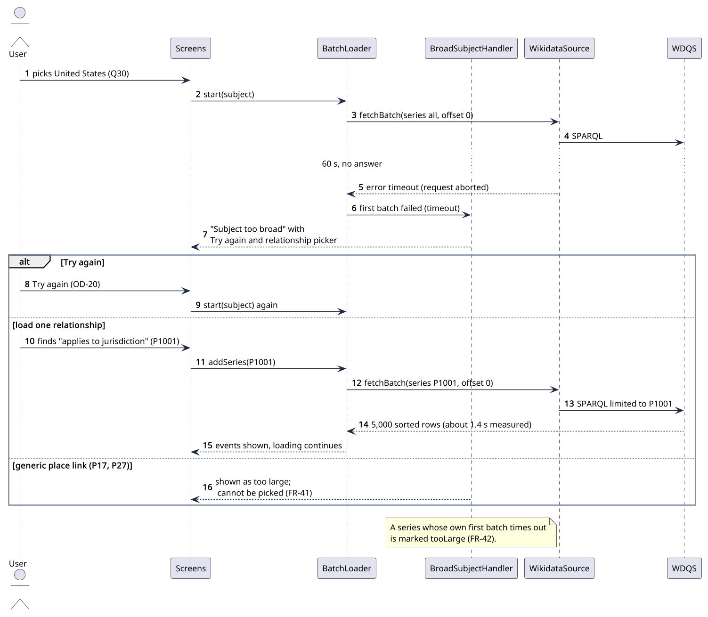
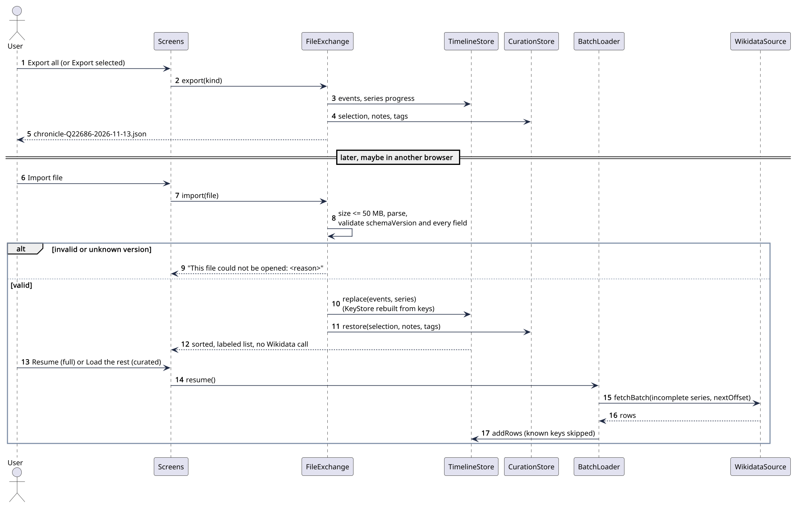
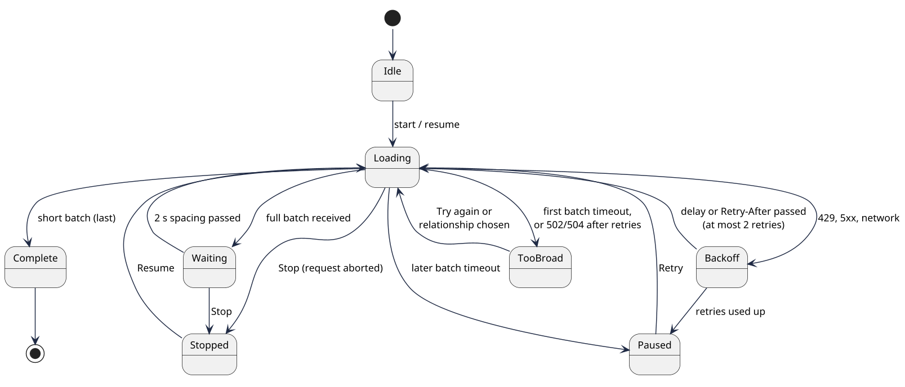
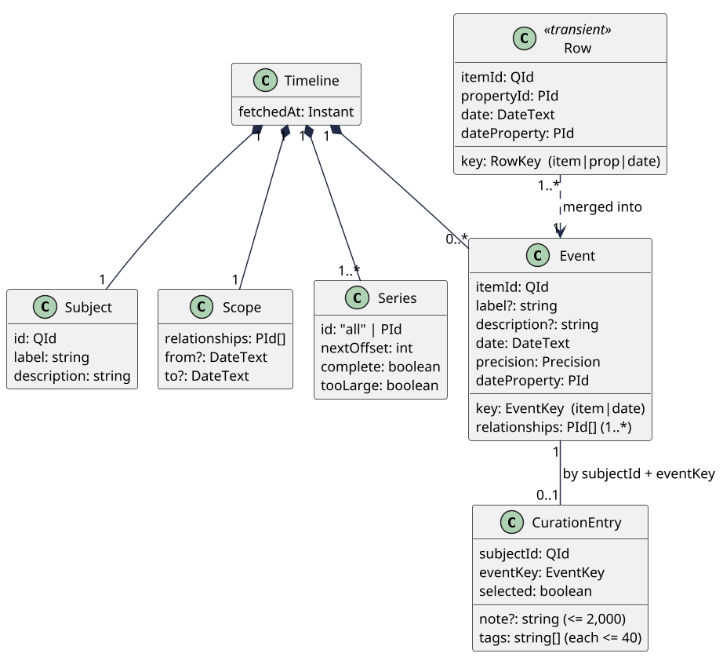

# Chronicle v1: Architecture and Design Document

How the searchable Wikidata timeline is built and tested  
Prepared by Filliciano Plong  
November 13, 2026  
Version 1.1  

## Contents

- [Revision history](#revision-history)
- [1. Context and scope](#1-context-and-scope)
- [2. Quality goals and scenarios](#2-quality-goals-and-scenarios)
- [3. Architectural style](#3-architectural-style)
- [4. Architecture views](#4-architecture-views)
- [5. Behavior and contract](#5-behavior-and-contract)
- [6. Data model and export format](#6-data-model-and-export-format)
- [7. Architecture decision records](#7-architecture-decision-records)
- [8. Security review](#8-security-review)
- [9. Test architecture](#9-test-architecture)
- [10. Technology stack](#10-technology-stack)
- [11. Risks and spikes](#11-risks-and-spikes)
- [12. Traceability](#12-traceability)
- [13. Design decisions](#13-design-decisions)
- [14. Maintenance and references](#14-maintenance-and-references)

## Revision history

| Version | Date | Changes |
|---|---|---|
| 1.0 | November 13, 2026 | First release, based on the Chronicle SRS version 1.3. |
| 1.1 | November 13, 2026 | Based on SRS version 1.4. Recorded OD-20 to OD-25 as decided; date precision is now always fetched in the query, with the spike result. Accepted the IndexedDB decision and confirmed the vis-timeline license. |

## 1. Context and scope

**Readers:** Filliciano Plong, to build and test Chronicle v1; reviewers, to see how the design meets the SRS.

Chronicle is a static website that turns one Wikidata subject into a date-sorted, filterable timeline. This document describes how the browser app is split into parts, how those parts talk to Wikidata, and how each part is tested. What the system must do is in the Chronicle SRS version 1.4, which this document cites by ID instead of repeating.

| Item | Summary |
|---|---|
| Actors | Visitor, researcher, reviewer, and the developer (SRS *4*). No accounts. |
| External systems | Wikidata Query Service (WDQS), the Wikidata API, and GitHub (repository, Actions, Pages). |
| Included | Everything in SRS *2.1*: search, batch loading, too-broad handling, export and import, curation, filters, links, visual timeline (Should). |
| Excluded | A backend, accounts, other data sources, editing Wikidata, non-English interface (SRS *2.2*). |
| Constraints | C-01 static site, C-02 Wikidata only, C-03 the stack, C-04 WDQS limits, C-05 public MIT repository, C-06 neutral presentation, C-07 free tiers. |

## 2. Quality goals and scenarios

Five goals drive the design, in priority order. Each design choice in *7. Architecture decision records* names the goal it serves.

| Goal | What it means here | Main NFRs |
|---|---|---|
| 1. Polite to Wikidata | One request at a time per lane, spacing, back-off, and no runaway retries. | NFR-09 to NFR-13, NFR-53 |
| 2. Correct timelines | No duplicates, no gaps, true date order, every event sourced. | NFR-16 to NFR-23 |
| 3. Testable | Every rule runs in CI without the network. | NFR-43 to NFR-49 |
| 4. Responsive | Events appear as they arrive; filtering stays fast at 20,000 events. | NFR-01 to NFR-08 |
| 5. Private | Nothing about the user leaves the browser except searches sent to Wikidata. | NFR-25 to NFR-35 |

The quality scenarios are the ones in SRS *7.8*, reused by ID. Numbers are targets, not measurements. The table shows which parts carry each scenario and how it is checked.

| QS | Scenario (short) | Components | ADR | Verification | NFR |
|---|---|---|---|---|---|
| QS-01 | First page within 10 s for a 2,000-event subject | BatchLoader, LabelFiller, RequestGate | ADR-003, ADR-004 | Timed live run on the reference laptop; E2E with recorded fixture for the flow | NFR-03 |
| QS-02 | Filter update within 200 ms at 20,000 events | ViewEngine | ADR-011 | Vitest benchmark on a 20,000-event fixture; S-02 | NFR-01 |
| QS-03 | Next page within 100 ms at 20,000 events | ViewEngine, Screens | - | Playwright timing on the fixture | NFR-07 |
| QS-04 | Batches combine into one timeline, no duplicates | BatchLoader, TimelineStore, KeyStore | ADR-004, ADR-007 | Unit: three recorded batches equal one unpaged fixture | NFR-17 |
| QS-05 | Visible labels within 2 s | LabelFiller | ADR-003 | Fault-injection E2E with delayed label route | NFR-04 |
| QS-06 | Too-broad message for the United States | BroadSubjectHandler, RequestGate | ADR-006, ADR-005 | E2E with a stalled route and a virtual clock | FR-35 |
| QS-07 | Select all filtered within 200 ms | CurationStore, ViewEngine | ADR-007 | Vitest benchmark | NFR-05 |
| QS-08 | Curated round trip with notes | FileExchange, CurationStore | ADR-010 | Round-trip test in a fresh browser context | NFR-20 |
| QS-09 | Resume fetches only the missing batch | FileExchange, BatchLoader, KeyStore | ADR-010, ADR-007 | Round-trip test counts requests | NFR-18 |
| QS-10 | HTTP 429 with Retry-After: 30 | RequestGate | ADR-008 | Unit with a fake clock; fault-injection E2E | FR-85 |
| QS-11 | Later batch hits 60 s | RequestGate, BatchLoader | ADR-008 | Fault-injection E2E: earlier events stay filterable | NFR-09 |
| QS-12 | Label containing script text | Screens, FileExchange | - | Unit and E2E with a synthetic fixture; T-01 | NFR-27 |
| QS-13 | Wikidata renames a response field | WikidataSource | ADR-002 | Weekly live contract job | NFR-49 |
| QS-14 | A v2 backend replaces direct calls | TimelineSource, WikidataSource | ADR-002 | Lint boundary rule; UI tests run against a fake source | NFR-44 |

## 3. Architectural style

Chronicle is a client-only, local-first single-page app with three layers. The **UI** (React) renders state and turns clicks into calls. The **core** is plain TypeScript with no React or network code, so its rules run in fast unit tests. The **data-access** layer is a port and adapter: the core talks to the `TimelineSource` interface, and `WikidataSource` is the v1 adapter (ADR-002).

Dependencies point inward: UI to core to the interface. A lint rule enforces this, so a screen can never call Wikidata directly (NFR-43). The planned source layout is below.

```
src/
  ui/      Screens, VisualTimeline, UrlState, hooks that subscribe to core stores
  core/    BatchLoader, BroadSubjectHandler, LabelFiller, TimelineStore, KeyStore,
           ViewEngine, CurationStore, FileExchange, LocalStore, dates.ts
  data/    TimelineSource.ts, WikidataSource/, RequestGate.ts, queries/
tests/
  fixtures/  recorded Wikidata responses with metadata
  unit/  contract/  roundtrip/  e2e/
```

## 4. Architecture views

All views use the component names in *Figure 4*. Diagrams are UML drawn with PlantUML; sources are in `docs/diagrams/`.

### 4.1 Use case



*Figure 1. Use case view*

**Purpose:** Show the ten SRS use cases, which ones extend finding a timeline, and which ones reach Wikidata.

**Assumption:** One kind of user; no account. Reviewers and the developer use the same screens.

**Limitation:** Steps and alternatives are in SRS *8*.

### 4.2 Context



*Figure 2. System context*

**Purpose:** Show that Chronicle talks only to two Wikidata services and is served by GitHub Pages.

**Assumption:** Both Wikidata services keep allowing browser calls from any origin (A-01).

**Limitation:** GitHub Actions and the weekly contract job are covered in *9. Test architecture*.

### 4.3 Containers and deployment



*Figure 3. Containers and deployment*

**Purpose:** Show where each part runs: static files on GitHub Pages, the app and IndexedDB in the browser, export files on the user's disk.

**Assumption:** HTTPS everywhere. The Content Security Policy is a meta tag, since GitHub Pages cannot set headers.

**Limitation:** No CDN or service worker in v1.

### 4.4 Components



*Figure 4. Component view*

**Purpose:** Show that only the data-access layer reaches the network, the core has no React code, and both stores persist through LocalStore.

**Assumption:** All components run in one browser tab. Hooks in Screens subscribe to core stores.

**Limitation:** Arrows show calls, not data flow. Error paths are in *Figure 8* and *5. Behavior and contract*.

Each component has one job. The table lists its responsibility and the requirements it carries.

| Component | Layer | Responsibility | Requirements |
|---|---|---|---|
| Screens | UI | Home, Timeline, and About screens: search box, filter panel, list, paging, selection, notes editor, progress, messages. Renders all text as plain text. | FR-01 to FR-07, FR-49 to FR-58, FR-82, FR-83, FR-122 to FR-124, NFR-27, NFR-36 to NFR-42 |
| VisualTimeline | UI | Should. Zoomable view of the filtered events, loaded as a separate chunk. | FR-78 to FR-81, NFR-08 |
| UrlState | UI | Reads and writes the view state in the URL; validates every parameter. | FR-71 to FR-77, NFR-29 |
| BatchLoader | Core | Runs each series of 5,000-row batches: start, next batch, Stop, Resume, Retry. Owns the loader state machine (*Figure 8*). | FR-25 to FR-34, FR-86, FR-94, FR-95, NFR-13, NFR-14 |
| BroadSubjectHandler | Core | Decides when a subject or relationship is too broad; offers Try again and relationship loading; knows the generic place links. | FR-35 to FR-43 |
| LabelFiller | Core | Queues IDs that need labels, visible page first, and fetches them 50 at a time. | FR-16, FR-17, FR-22, NFR-04 |
| TimelineStore | Core | Holds the loaded events in sorted order; merges rows into events; keeps series progress. | FR-19 to FR-21, FR-24, FR-44, NFR-16, NFR-17 |
| KeyStore | Core | Set of loaded row keys; drops any row already seen. | FR-19, FR-20, FR-112, NFR-18 |
| ViewEngine | Core | Applies text, relationship, date, and tag filters, sort, and paging over all loaded events. | FR-58 to FR-70, FR-113, FR-116, FR-121, NFR-01, NFR-05, NFR-07 |
| CurationStore | Core | Selection, notes, and tags by subject and event key; saves them through LocalStore. | FR-99 to FR-120, NFR-21, NFR-28, NFR-32, NFR-33 |
| FileExchange | Core | Export all, Export selected, and import with schema checks; CSV download (Could). | FR-90 to FR-98, FR-106 to FR-112, FR-118, FR-119, NFR-19, NFR-20, NFR-30, NFR-31 |
| LocalStore | Core | IndexedDB wrapper: 24-hour timeline cache and curation entries. | FR-88, FR-89, FR-117, FR-120 |
| TimelineSource | Data access | Source-neutral interface: subject search, property search, one batch, labels. The v2 backend seam. | NFR-43, NFR-44 |
| WikidataSource | Data access | Implements TimelineSource against WDQS and the Wikidata API: builds queries, parses JSON results, maps errors. | FR-02, FR-03, FR-08, FR-09, FR-12 to FR-18, FR-23, FR-39, NFR-22, NFR-23, NFR-53 |
| RequestGate | Data access | The only caller of fetch: one query and one API request at a time, 2 s between batches, 60 s abort, retries, Retry-After. | FR-84 to FR-87, NFR-09 to NFR-12 |

### 4.5 Sequence: search to first batch



*Figure 5. Search to first batch*

**Purpose:** Show the normal path: suggestions after a typing pause, the first unlabeled batch shown at once, labels filled in, and the next batch after 2 s.

**Assumption:** An ordinary subject such as Donald Trump (1,897 rows, one batch).

**Limitation:** Retries and errors are in *Figure 8*. The cache check before step 8 is left out.

### 4.6 Sequence: too-broad subject



*Figure 6. Batch timeout to relationship loading*

**Purpose:** Show how a first-batch timeout becomes the too-broad message, and how the user continues with Try again or one relationship.

**Assumption:** The United States (Q30), measured on Nov 13, 2026 (SRS *Appendix A*).

**Limitation:** Several relationships can be added; each one is its own series.

### 4.7 Sequence: export, import, and resume



*Figure 7. Export, import, and resume*

**Purpose:** Show that an imported file opens with no Wikidata call, and that resuming fetches only incomplete series while KeyStore drops repeats.

**Assumption:** The file was made by Chronicle with `schemaVersion` 1.

**Limitation:** Where Resume starts for stored timelines is OD-21.

### 4.8 State: batch loader



*Figure 8. Batch loader states*

**Purpose:** Show every state of one series and what moves it, including Stop, Resume, back-off, pause, and too broad.

**Assumption:** One series is loading at a time; others wait in order.

**Limitation:** Label loading has its own simple queue and is not shown.

## 5. Behavior and contract

The critical operation is loading one batch. `BatchLoader` asks `TimelineSource.fetchBatch` for rows, and every outcome has a defined handling. The interface below is the seam a v2 backend implements.

```ts
interface TimelineSource {
  searchSubjects(text: string, signal: AbortSignal): Promise<SubjectHit[]>;
  searchProperties(text: string, signal: AbortSignal): Promise<PropertyHit[]>;
  fetchBatch(req: BatchRequest, signal: AbortSignal): Promise<BatchResult>;
  fetchLabels(ids: EntityId[], signal: AbortSignal):    // up to 50 IDs
    Promise<Map<EntityId, LabelText>>;
}

type BatchRequest = {
  subjectId: QId;                  // ^Q[1-9][0-9]*$
  series: "all" | PId;             // whole subject, or one relationship
  scope: { relationships: PId[]; from?: DateText; to?: DateText };
  offset: number;                  // multiple of 5,000
  limit: 5000;
};

type BatchResult =
  | { ok: true; rows: Row[] }      // sorted by date, item, property; no labels
  | { ok: false; error: SourceError };

type SourceError =
  | { kind: "timeout" }                          // no answer in 60 s
  | { kind: "rateLimited"; retryAfterS: number } // HTTP 429
  | { kind: "server"; status: number }           // 5xx after retries
  | { kind: "badQuery" }                         // HTTP 400, never retried
  | { kind: "network" } | { kind: "badShape"; detail: string } | { kind: "aborted" };
```

| Part | Rule |
|---|---|
| Input | A validated subject ID, series, scope, and offset (NFR-29). Built from a fixed SPARQL template, never string-pasted user text. |
| Output | Rows of item, property, date, date property, and precision, in the SPARQL JSON results format (FR-18). |
| State changes | On success, `TimelineStore` adds new rows and the series' next offset moves on by 5,000. Nothing changes on failure. |
| Atomicity | A batch is applied whole or not at all, so a failed or aborted batch can simply be fetched again. |
| Retry | Only RequestGate retries, and only network errors and 5xx (twice). Everything else goes back to BatchLoader (ADR-008). |
| Authorization | None; both services are public and need no key. |

| Outcome | BatchLoader does | User sees (SRS *Error message reference*) |
|---|---|---|
| Full batch | Shows events, waits 2 s, fetches the next offset | Loading in progress |
| Short batch | Marks the series complete; starts the next series if any | Event count, no progress bar |
| Timeout, first batch of a series | Hands to BroadSubjectHandler; series marked too broad or too large | Subject too broad, or Relationship too large |
| Timeout, later batch | Pauses; keeps all events (NFR-14) | Loading paused, with Retry |
| Rate limited (429) | RequestGate waits Retry-After, then retries once | Wikidata is busy. Retrying in N seconds. |
| Server error after retries | Pauses; first batch with 502 or 504 counts as too broad (FR-36) | Wikidata had a problem, with Retry |
| Bad query (400) | Stops the series; logs the query text to the console | This is a Chronicle bug |
| Network | Pauses; filters keep working (NFR-15) | You appear to be offline |
| Bad shape | Pauses; treated like a bug | Wikidata had a problem |
| Aborted (Stop or new subject) | Keeps events; series stays incomplete | Nothing, or the new subject |

The query is shaped like the sketch below. The exact text lives in `src/data/queries/` and is pinned by contract tests.

```sparql
SELECT ?item ?prop ?date ?dateProp ?precision WHERE {
  ?item ?p wd:Q22686 .                       # series "all"; or: ?item wdt:P1001 wd:Q30
  ?prop wikibase:directClaim ?p .
  VALUES (?dateProp ?value) { (p:P585 psv:P585) (p:P577 psv:P577)
                              (p:P580 psv:P580) (p:P571 psv:P571) }
  ?item ?dateProp ?st .
  ?st a wikibase:BestRank ; ?value ?v .        # same rows as wdt: (spike S-01)
  ?v wikibase:timeValue ?date ; wikibase:timePrecision ?precision .
  # optional scope: FILTER(?date >= "1900-01-01"^^xsd:dateTime) and VALUES ?p { ... }
}
ORDER BY ?date ?item ?prop
LIMIT 5000 OFFSET 0
```

## 6. Data model and export format

### 6.1 Entities



*Figure 9. Class view of the data model*

**Purpose:** Show that rows are transient and merge into events, a timeline has one or more series, and curation entries link to events by key.

**Assumption:** Field types and null rules follow SRS *9.1*. `DateText` is Wikidata's time text, such as `-0043-03-15T00:00:00Z`.

**Limitation:** Labels for relationships (P-IDs) live in a small label map, not shown.

### 6.2 Rules and where they are enforced

Each data rule has one owner and one test. Example data in tests is recorded from Wikidata or made up; it never includes anyone's notes.

| Rule | Enforced in | Verified by |
|---|---|---|
| Subject IDs match `^Q[1-9][0-9]*$`; property IDs match `^P[1-9][0-9]*$` | UrlState, FileExchange, WikidataSource | Unit (NFR-29, NFR-30) |
| Row keys are unique among loaded rows | KeyStore | Round trip (NFR-18) |
| Event key is item ID + date; an event has one or more relationships | TimelineStore | Unit (FR-21) |
| Dates stay as text; order uses sign, year of any length, month, day | core `dates.ts` | Unit with BCE and five-digit years (NFR-23) |
| Every event has a precision from `wikibase:timePrecision` (11 day, 10 month, 9 year, lower is coarser); dates show only to that precision | WikidataSource, `dates.ts`, Screens | Unit and the BCE and year-only acceptance test (FR-46) |
| Negative years follow the query service's date form, where year 0 is 1 BCE, so `-0043` shows as 44 BCE (**UNVERIFIED:** WDQS RDF format notes on mediawiki.org; pin with the Julius Caesar fixture) | `dates.ts` | Unit (FR-45) |
| When several date properties give the same date, the first in the *Date property reference* order wins | TimelineStore | Unit (FR-24) |
| A missing label is absent, shown as the ID; a missing description is an empty string | LabelFiller, Screens | Unit (FR-17) |
| Source links are built from the item ID, never stored or imported | Screens | Unit and import test (T-02) |
| A curation entry exists only while selected, noted, or tagged | CurationStore | Unit |
| Notes are at most 2,000 characters; tags are trimmed, at most 40 characters, unique ignoring case | CurationStore, FileExchange | Unit (NFR-32) |
| Cache entries expire 24 hours after `fetchedAt` | LocalStore | Unit with a fake clock (FR-88) |
| All timestamps are ISO 8601 in UTC | FileExchange, LocalStore | Schema test |

**Sensitive data:** notes and tags are the user's own writing. They are stored unencrypted in IndexedDB and in exported files, and the About page says so. Retention is decided: cache 24 hours, curation until the user deletes it (SRS *9.3*).

### 6.3 Export file format

`FileExchange` writes and reads one JSON format. Version 1 is below; the zod schema in `src/core/exportSchema.ts` is the source of truth, and a JSON Schema copy can be generated from it later.

| Field | Type and rule | On import |
|---|---|---|
| `schemaVersion` | Integer, 1 | Any other value is rejected (FR-96) |
| `kind` | `full` or `curated` | Required (FR-109) |
| `exportedAt`, `fetchedAt` | ISO 8601 UTC text | Shown to the user (FR-97) |
| `subject` | `id`, `label`, `description` | ID pattern checked |
| `scope` | `relationships` (P-IDs), optional `from` and `to` | Restored to the search form |
| `view` | `filters`, `sort`, `page` | Restored; invalid values dropped (FR-93) |
| `progress` | Full files only: series with `id`, `nextOffset`, `complete`, `tooLarge` | Drives Resume (FR-94, FR-95) |
| `events[]` | In sorted order: `key`, `itemId`, `label`, `description`, `date`, `precision` (`day`, `month`, `year`, `decade`, `century`, or `millennium`), `dateProperty`, `relationships` | Every field checked; keys rebuilt and compared |
| `events[].selected` | Boolean; true for every event in a curated file | Restores selection (FR-110) |
| `events[].note`, `events[].tags` | Optional; limits in NFR-32 | Restored (FR-119) |
| Unknown fields | Not allowed in files Chronicle writes | Ignored and not written back |

```json
{
  "schemaVersion": 1,
  "kind": "curated",
  "exportedAt": "2026-11-13T18:30:00Z",
  "fetchedAt": "2026-11-13T18:02:11Z",
  "subject": { "id": "Q22686", "label": "Donald Trump",
               "description": "president of the United States" },
  "scope": { "relationships": [] },
  "view": { "filters": { "text": "paris" }, "sort": "asc", "page": 1 },
  "events": [{
    "key": "Q12345|2017-06-01T00:00:00Z", "itemId": "Q12345",
    "label": "Example event", "description": "", "date": "2017-06-01T00:00:00Z",
    "precision": "day", "dateProperty": "P585", "relationships": ["P710"],
    "selected": true, "note": "Check the primary source.", "tags": ["climate"]
  }]
}
```

Versioning rules: a reader accepts its own version and every older one through small migration functions. A file from a newer Chronicle is rejected with the message "made by a newer version". Each version change adds a fixture file and a round-trip test. The example values are made up.

### 6.4 Browser storage layout

| Store | Key | Value | Lifetime |
|---|---|---|---|
| `timelines` | subject ID + scope | subject, scope, series, events with labels, `fetchedAt` | 24 hours, or until Refresh |
| `curation` | subject ID + event key; index on subject ID | `selected`, `note`, `tags`, `updatedAt` | Until the user deletes it |

The IndexedDB database is named `chronicle` and starts at version 1. Expired cache entries are removed on read and once at startup.

## 7. Architecture decision records

Each record follows Michael Nygard's format. All records are accepted; the status names the decision or date. Smaller choices that need no record are in *10. Technology stack*.

### ADR-001 No backend in v1: a static site on GitHub Pages

| Field | Record |
|---|---|
| Status | Accepted (C-01, Nov 13, 2026) |
| Context | The owner wants a free, public portfolio site (C-01, C-07). Wikidata allows browser calls from any origin (A-01). Big subjects would benefit from a server, but v1 has to stay simple. |
| Decision | The app is static files built by Vite and served from GitHub Pages under `/chronicle/` (NFR-52).<br>The browser calls Wikidata directly. Everything the user keeps lives in the browser or in files they export. |
| Alternatives | A small server or serverless proxy with caching: costs money, needs operating, and would hold user data. A server-rendered site: same costs, and no gain for a single-user tool. |
| Consequences | Free hosting and no user data on any server. Each visitor's browser queries Wikidata, so Chronicle must be polite (ADR-008), and country-sized timelines stay out of reach until v2. |
| Revisit when | Traffic grows past the low-use assumption (A-03), or v2 starts. |

### ADR-002 One data-access layer behind a source-neutral TimelineSource interface (the v2 seam)

| Field | Record |
|---|---|
| Status | Accepted (NFR-43, NFR-44) |
| Context | v2 will add a backend built from Wikidata dumps (OD-14). Tests must run without the network (NFR-47). |
| Decision | `TimelineSource` is the only way the core reaches data. `WikidataSource` implements it for v1.<br>`RequestGate` is the only code that calls `fetch`. An ESLint rule bans `fetch` and imports of `src/data` internals elsewhere.<br>The interface speaks in Chronicle terms (subject, series, batch, labels), never in SPARQL. |
| Alternatives | Calling Wikidata from React hooks: quick, but couples screens to SPARQL and blocks the v2 swap. A general HTTP client wrapper only: does not hide the query language. |
| Consequences | A v2 `BackendSource` replaces one module, and UI tests run against a `FakeSource`. Costs one thin layer of mapping code. |
| Revisit when | v2 design starts, or a second data source is added. |

### ADR-003 Fetch rows without labels; fill labels separately with wbgetentities

| Field | Record |
|---|---|
| Status | Accepted (OD-13) |
| Context | With the SPARQL label service, 5,000-row batches for big subjects timed out. Without it, a World War II batch took 5.9 s and a 50-ID label lookup 0.55 s (SRS *Appendix A*). |
| Decision | Batch queries return item, property, date, date property, and date precision only (FR-15).<br>`LabelFiller` asks for English labels and descriptions, 50 IDs per request, visible page first (FR-16, FR-22).<br>Until a label arrives, the Q-ID or P-ID is shown (FR-17). |
| Alternatives | Label service in the query: simpler, but times out on big subjects. Labels only for the visible page: fewer requests, but the text filter needs every label. |
| Consequences | Big subjects load. Labels arrive a moment later and the text filter matches only labeled events until then; the progress line says so. Many more small API requests, one at a time. |
| Revisit when | WDQS label performance changes, or v2 serves labels. |

### ADR-004 Batches by sorted LIMIT and OFFSET, one series at a time

| Field | Record |
|---|---|
| Status | Accepted (OD-07) |
| Context | WDQS stops any query at 60 s (C-04). Results must be complete and free of duplicates (NFR-17). |
| Decision | Each batch is `ORDER BY ?date ?item ?prop LIMIT 5000 OFFSET n` (FR-25, FR-26).<br>The next batch starts at least 2 s after the previous one finished (NFR-13); a short batch ends the series (FR-33).<br>Each batch is shown as soon as it arrives (FR-29). |
| Alternatives | Unsorted paging: faster for the US (0.6 s), but rows can repeat or go missing between pages. Keyset paging (date greater than the last date): not reliable with many rows on the same date. |
| Consequences | Simple and correct for a fixed dataset. WDQS re-runs the full query for every OFFSET, so each batch costs about as much as the first, and later batches can time out on large subjects (R-01). |
| Revisit when | A batch for an ordinary subject times out in live use, or WDQS adds a way to page without OFFSET. |

### ADR-005 Do not split broad subjects into date windows

| Field | Record |
|---|---|
| Status | Accepted (Nov 13, 2026 load test) |
| Context | Year-by-year loading looked like a way to load a country slowly. In the test, every window for the United States timed out, even July 1776 (SRS *Appendix A*): WDQS gathers every linked item before applying the date filter. |
| Decision | No date-window splitting in the loader.<br>The date range on the search form stays, as a way to narrow ordinary subjects (FR-07), not as a fix for broad ones (FR-43). |
| Alternatives | Year windows; adaptive windows that shrink after a timeout. Both cost as much as the full query. |
| Consequences | One less loading strategy to build and test. Country-sized timelines wait for v2. |
| Revisit when | WDQS changes its query planner, or a measured window finishes within 60 s. |

### ADR-006 Too-broad subjects load one relationship at a time

| Field | Record |
|---|---|
| Status | Accepted (OD-14, OD-16) |
| Context | "Applies to jurisdiction" for the United States returned 5,000 sorted rows in 1.4 s, while the generic "country" link timed out even for one year (SRS *Appendix A*). |
| Decision | A subject is too broad when its first batch gets no answer within 60 s, or 502 or 504 errors persist after retries (FR-35, FR-36).<br>`BroadSubjectHandler` shows the too-broad message with Try again and a relationship picker that uses property search (FR-37 to FR-39).<br>Each chosen relationship is its own series (FR-40). P17 and P27 are shown as too large (FR-41); any series whose first batch times out is marked too large (FR-42). |
| Alternatives | Refuse broad subjects: unhelpful. Unsorted paging: no correctness guarantee. Requiring a relationship for every search: adds friction to the common case. |
| Consequences | Broad subjects stay useful. The user has to know or find a relationship, and some relationships are themselves too large. |
| Revisit when | The v2 backend can serve full country timelines. |

### ADR-007 Row keys and a KeyStore make every load path duplicate-free

| Field | Record |
|---|---|
| Status | Accepted (OD-15) |
| Context | Rows arrive from batches, retries, Resume, cache, and import. The sample data had 97 exact duplicate rows (SRS *9.2*). |
| Decision | Row key = item ID + property ID + date (FR-19). `KeyStore` keeps a set of keys; `TimelineStore` adds a row only when its key is new (FR-20).<br>Rows with the same item ID and date merge into one event; the event key is item ID + date (FR-21).<br>Selection, notes, and tags attach to event keys, never to positions (FR-104). |
| Alternatives | Trust OFFSET alone: fails on retries and resumes. Hash whole rows: breaks when a label changes. |
| Consequences | One rule covers every path, and it is easy to test. The set costs memory, about 1 MB per 20,000 keys (estimate). |
| Revisit when | Wikidata adds a second value for the same item, property, and date that should stay separate. |

### ADR-008 One RequestGate owns pacing, timeouts, and retries

| Field | Record |
|---|---|
| Status | Accepted (OD-17) |
| Context | WDQS allows 60 s of processing per minute per client and answers 429 with Retry-After (C-04). A retry-loop bug could hurt a shared service (T-04). |
| Decision | Two lanes: one query and one API request in flight at a time (NFR-12).<br>Queries are aborted at 60 s (NFR-09). Network errors and 5xx are retried at most twice, after 2 s and then 8 s (target) (NFR-10). 400 is never retried (NFR-11).<br>429 waits for Retry-After, or 30 s when the header is missing (proposed) (FR-85). A timeout is never retried without the user; the caller decides.<br>Every request carries the `Api-User-Agent` header (NFR-53). Picking another subject aborts the running query (FR-86). |
| Alternatives | Retry logic in each caller: duplicated and hard to prove. A generic retry library: does not know WDQS rules. |
| Consequences | All politeness rules live in one tested module with a fake clock. The 2 s spacing slows big loads slightly. |
| Revisit when | Wikimedia changes its limits, or 429s show up in normal use. |

### ADR-009 IndexedDB for the 24-hour cache and for curation

| Field | Record |
|---|---|
| Status | Accepted (Nov 13, 2026) |
| Context | A 20,000-event timeline is several megabytes. Notes must survive reloads (FR-117). localStorage is small and blocks the page. |
| Decision | `LocalStore` wraps IndexedDB through the small `idb` library.<br>Store `timelines`: one entry per subject and scope, deleted 24 hours after fetch or on Refresh (FR-88, FR-89).<br>Store `curation`: one entry per subject and event key, no expiry; deleted only by the user (FR-120).<br>When a write fails for quota, the note stays on screen with a warning (NFR-33). |
| Alternatives | localStorage: about 5 MB and synchronous (**UNVERIFIED:** per-browser limits on MDN). Cache API: built for HTTP responses, awkward for records. No persistence: loses notes. |
| Consequences | Room for large timelines and async writes. Browsers may still evict site data (R-06), so export stays the safe copy. |
| Revisit when | A browser drops IndexedDB support, or v2 offers saved collections. |

### ADR-010 Versioned JSON export, validated as untrusted on import

| Field | Record |
|---|---|
| Status | Accepted (OD-15, OD-18) |
| Context | Files are how users keep, resume, and share timelines and curated research (FR-90 to FR-112). Files may be edited or crafted (NFR-30). |
| Decision | One format with `schemaVersion` 1 and `kind` `full` or `curated` (FR-109). The fields are in *6.3 Export file format*.<br>Import checks size (50 MB), then parses and validates every field with a zod schema before anything touches the stores (NFR-30, NFR-31).<br>Unknown versions are rejected with a reason (FR-96). Unknown fields are ignored and not written back.<br>Source links are rebuilt from item IDs, never read from the file. |
| Alternatives | Saving IndexedDB contents directly: not portable. CSV: loses progress and notes. An unversioned format: cannot evolve. |
| Consequences | Portable, testable files with a clear upgrade path. Each future version needs a small migration function and tests. |
| Revisit when | A field is added or changed; bump `schemaVersion` and add a migration. |

### ADR-011 The URL is the source of truth for view state

| Field | Record |
|---|---|
| Status | Accepted (FR-71 to FR-77) |
| Context | Every view must be shareable and Back must work (FR-72, FR-77). GitHub Pages has no server-side routing. |
| Decision | `UrlState` parses query parameters on `/chronicle/` into a typed view state and writes changes back.<br>Subject and page changes push a history entry; filter typing replaces it, after a short pause.<br>The About page is a second static entry at `/chronicle/about/`, so no 404 trick is needed. |
| Alternatives | Hash routing: works, but uglier links. Keeping state only in memory: no sharing. |
| Consequences | Shared links and Back work, and tests can open any state directly. Invalid parameters are ignored and named (FR-74). |
| Revisit when | The site moves to a host with routing, or v2 adds paths. |

## 8. Security review

Chronicle has no server and no accounts, so the assets are the user's browser, their notes, and Wikidata's goodwill. The boundaries are data coming from Wikidata, files and links coming from other people, requests leaving for Wikidata, and the build. This is a design review, not a penetration test or a security guarantee.

| ID | Threat (boundary) | Impact | Mitigation | Test (NFR) |
|---|---|---|---|---|
| T-01 | Script injection through Wikidata labels or descriptions (data from Wikidata into the page) | Script runs in the user's browser; could read notes | React text rendering only; lint ban on `dangerouslySetInnerHTML` and `innerHTML`; CSP | QS-12 fixture with `<script>` and `onerror` text (NFR-27, NFR-34) |
| T-02 | Crafted import file (file into the app): script text, `javascript:` links, huge size, deep nesting, `__proto__` keys | Script injection, frozen tab, polluted objects | 50 MB limit; zod validation into fresh objects; ID patterns; source links rebuilt from item IDs; text rendered as text | Malformed-file test set in the round-trip layer (NFR-30, NFR-31) |
| T-03 | Crafted shared URL that tries to inject SPARQL through `q`, `rel`, or `srel` | Bad queries sent to Wikidata in the user's name | IDs must match `^Q[1-9][0-9]*$` or `^P[1-9][0-9]*$`; dates parsed, not pasted; queries built from a fixed template | Unit tests with injection strings (NFR-29, FR-74) |
| T-04 | A bug or shared link makes browsers flood WDQS (app to Wikidata) | Wikidata slowed for everyone; Chronicle blocked | RequestGate lanes, spacing, retry cap, no timeout retries without the user | Unit with fake clock; E2E request counter (NFR-10 to NFR-13) |
| T-05 | Compromised npm dependency ships in the bundle (build boundary) | Any of the above | Few dependencies; lockfile; `npm audit` gate; license check | CI fails on high or critical findings (NFR-35, NFR-54) |
| T-06 | Notes, tags, or searches leak to a third party (app to network) | Loss of the user's private research | No analytics or cookies; CSP `connect-src` limited to Wikidata hosts; notes never leave except in exported files | E2E network log allows only the endpoint hosts (NFR-25, NFR-26, NFR-28) |
| T-07 | Someone else using the same browser profile reads saved notes (storage at rest) | Notes disclosed; they are not encrypted | About page says notes stay in this browser unencrypted; Delete saved data for a subject (FR-120) | Inspection; E2E for delete |
| T-08 | Network attacker changes Wikidata responses in transit | False events shown | HTTPS only; CSP `upgrade-insecure-requests`; GitHub Pages enforced HTTPS | Inspection of CSP and Pages setting |
| T-09 | The site is framed by another page (clickjacking) | Low: no account or payment actions | Accepted. GitHub Pages cannot send `frame-ancestors`, and the meta CSP ignores it (**UNVERIFIED:** CSP spec) | None; revisit if a host with headers is used |

The Content Security Policy meta tag will allow scripts and styles only from the site itself, and connections only to `query.wikidata.org` and `www.wikidata.org` (NFR-34).

## 9. Test architecture

Tests are a main part of the project. Every layer in the SRS *Test layer reference* runs on each pull request, against recorded responses, with no live calls (NFR-47, NFR-48). Only the weekly contract job reaches the live services.

### 9.1 Layers

| Layer | What runs | Main components | Tools |
|---|---|---|---|
| Unit | Parsing, keys, merging, date order, filters, URL state, gate timing with a fake clock | Core, RequestGate, UrlState | Vitest |
| Contract | Recorded responses still parse; the weekly job replays the same requests live and compares shapes | WikidataSource | Vitest |
| Data validation | Every event in every fixture has a date, a label or ID, and a source link | TimelineStore | Vitest |
| Round trip | Full and curated export then import; resume; load the rest; malformed files | FileExchange, CurationStore, KeyStore | Vitest, fast-check |
| End-to-end | The ten use cases in the supported browsers, against fixture routes | Screens and everything below | Playwright |
| Fault injection | Timeouts, 429 with Retry-After, 502 and 504, offline, slow labels, bad JSON | RequestGate, BatchLoader, BroadSubjectHandler | Playwright routes and clock |
| Accessibility | Home, timeline, too broad, import error, and notes editor states | Screens | @axe-core/playwright |
| Static | Strict types, lint, the data-access boundary rule, licenses, audit | All | TypeScript, ESLint, npm audit |

### 9.2 Fixtures and fakes

- A small script, run by hand, records real Wikidata responses into `tests/fixtures/` with the request, the time, and the query text. It spaces requests out like the app does.
- Planned fixtures: Donald Trump (one batch), California (11,100 rows, three batches, for QS-04 and QS-09), labels, property search, a BCE subject such as Julius Caesar, and synthetic files for script text and malformed imports.
- `FakeSource` implements `TimelineSource` from fixtures, so UI and core tests never touch `fetch` (NFR-44).
- `BatchLoader` and `RequestGate` take a `Clock`, so a 60 s timeout or a 30 s Retry-After runs in milliseconds.
- fast-check generates random batch splits, repeats, and resume points; the result must equal the unpaged fixture.

### 9.3 Continuous integration

| Workflow | When | Steps |
|---|---|---|
| `ci.yml` | Every pull request | Install from lockfile; typecheck; lint; unit, contract, data, and round-trip tests with coverage (NFR-46); build; Playwright E2E, fault injection, and axe in each browser project; license check; audit |
| `contract-weekly.yml` | Weekly schedule | Live contract run for small subjects; opens nothing, just fails and names the changed field (NFR-49) |
| `deploy.yml` | Push to `main` | Build and publish to GitHub Pages (NFR-52) |

Branch rules require `ci.yml` to pass before merging (NFR-48). Playwright projects follow the SRS *Browser support reference*: Chromium, Firefox, and WebKit on desktop, plus mobile emulation.

## 10. Technology stack

Versions are the latest stable releases at project setup, pinned in `package-lock.json`. **UNVERIFIED:** check current versions and licenses on each project's site at setup; vis-timeline's was checked on Nov 13, 2026.

| Layer | Technology | Why | License |
|---|---|---|---|
| Language | TypeScript, strict mode | Types for IDs, rows, and errors (NFR-45) | Apache-2.0 |
| UI | React | Common, well tested, plain-text rendering by default | MIT |
| Build | Vite, two entries (`/` and `/about/`) | Fast builds; static output for Pages | MIT |
| Storage | IndexedDB through `idb` | Small async wrapper (ADR-009) | ISC |
| Validation | zod | One schema for import checks and types (ADR-010) | MIT |
| Visual timeline | vis-timeline 8.5.6, lazy-loaded (OD-23) | Zoom and pan without building it from scratch | Apache-2.0 OR MIT (checked) |
| Unit and contract | Vitest, fast-check | Fast; works with Vite | MIT |
| End-to-end | Playwright with `@axe-core/playwright` | Three browser engines, routes, clock | Apache-2.0, MPL-2.0 |
| Lint | ESLint with typescript-eslint | Boundary and `innerHTML` rules | MIT |
| CI and hosting | GitHub Actions, GitHub Pages | Free for public repositories (C-07) | Service |

## 11. Risks and spikes

Owner for every risk: Filliciano Plong. Likelihood and impact are judgments, not measurements.

| ID | Risk | Likelihood | Impact | Mitigation |
|---|---|---|---|---|
| R-01 | WDQS timing varies; the same query took 24 s once and timed out another time, so an ordinary subject may look too broad. | Medium | Medium | Try again on the too-broad message (FR-38); retries for 502 and 504 first (FR-36). |
| R-02 | Wikidata changes response shapes, CORS, header rules, or limits. | Low | High | Weekly live contract job (NFR-49); all calls in one layer (ADR-002). |
| R-03 | Wikidata edits between Stop and a later Resume shift OFFSET positions, so a resumed series can skip rows. | Medium | Low | Overlap one batch when resuming stored timelines (OD-21); Refresh for a full reload (FR-97). |
| R-04 | Fetching precision through the statement path adds time: 1 to 11 s per batch in S-01. Donald Trump's single batch took 12.8 s cold, above the 10 s first-page target (NFR-03). | Medium | Low | Show each batch as soon as it arrives; 24-hour cache; recheck timings in the weekly contract job; revisit the NFR-03 target with real measurements. |
| R-05 | Filtering 20,000 events on a mid-range phone misses 200 ms. | Medium | Medium | Precomputed search text; memoized results; a Web Worker if S-02 says so. |
| R-06 | Browsers evict site storage; Safari may clear it after 7 days without a visit (**UNVERIFIED:** WebKit storage policy). | Medium | High | Ask for persistent storage (OD-24); remind users to export; About page explains it. |
| R-07 | Scholarly articles are in a separate WDQS graph, so papers about a subject are missing (OD-19). | High | Low | Say so on the About page; v2 may add the second endpoint. |
| R-08 | The visual timeline library breaks the 300 KB JavaScript budget (NFR-08). | Medium | Low | Load it as a separate chunk only when the user opens that view (OD-23). |
| R-09 | The generic place link list (P17, P27) is incomplete, so users wait 60 s on other huge relationships. | Medium | Low | Mark any relationship that times out (FR-42); add to the list from contract runs. |
| R-10 | Many users behind one school or office IP share the WDQS limit and get 429s. | Low | Medium | Retry-After handling and clear message (FR-85); cache (FR-88). |
| R-11 | Two tabs edit notes for the same subject; the last write wins. | Low | Low | Write per event, not per subject; document it. |

Short spikes settle the risks that a test can answer before the feature is built.

| ID | Spike | Settles |
|---|---|---|
| S-01 | Done Nov 13, 2026. Batch times with and without `wikibase:timePrecision` for Donald Trump and World War II, in SRS *Appendix A.3* | OD-22, R-04 |
| S-02 | Filter and page a 20,000-event fixture on a mid-range phone | QS-02, R-05 |
| S-03 | Write 20 MB to IndexedDB in Chrome, Firefox, and Safari; check `navigator.storage.persist()` | ADR-009, OD-24 |
| S-04 | Try vis-timeline on 5,000 events; measure the chunk size | OD-23, R-08 |

## 12. Traceability

Every Must requirement maps to at least one component. Use cases map to the views that show them.

| SRS IDs | SRS section | Components and ADRs |
|---|---|---|
| FR-01 to FR-11 | 6.1 Subject search | Screens, TimelineSource, WikidataSource |
| FR-12 to FR-24 | 6.2 Timeline query | WikidataSource, LabelFiller, TimelineStore, KeyStore; ADR-003, ADR-007 |
| FR-25 to FR-34 | 6.3 Batch loading | BatchLoader, RequestGate; ADR-004, ADR-008 |
| FR-35 to FR-43 | 6.4 Too-broad subjects | BroadSubjectHandler, BatchLoader; ADR-005, ADR-006 |
| FR-44 to FR-48 | 6.5 Dates | TimelineStore (`dates.ts`), Screens |
| FR-49 to FR-58 | 6.6 Timeline list | Screens, ViewEngine |
| FR-59 to FR-70 | 6.7 Filters | ViewEngine |
| FR-71 to FR-77 | 6.8 Shareable links | UrlState; ADR-011 |
| FR-78 to FR-81 | 6.9 Visual timeline | VisualTimeline (OD-23) |
| FR-82 to FR-89 | 6.10 Loading, errors, caching | RequestGate, BatchLoader, Screens, LocalStore; ADR-008, ADR-009 |
| FR-90 to FR-98 | 6.11 Export and import | FileExchange, BatchLoader; ADR-010 |
| FR-99 to FR-121 | 6.12 Curation | CurationStore, ViewEngine, FileExchange, LocalStore; ADR-007, ADR-009 |
| FR-122 to FR-124 | 6.13 About and attribution | Screens |
| NFR-01 to NFR-08 | 7.1 Performance | ViewEngine, LabelFiller, VisualTimeline chunk |
| NFR-09 to NFR-15 | 7.2 Reliability | RequestGate, BatchLoader; ADR-008 |
| NFR-16 to NFR-24 | 7.3 Data correctness | TimelineStore, KeyStore, FileExchange; ADR-007, ADR-010 |
| NFR-25 to NFR-35 | 7.4 Security and privacy | Screens, UrlState, FileExchange, CurationStore; *8. Security review* |
| NFR-36 to NFR-42 | 7.5 Usability and accessibility | Screens; axe layer |
| NFR-43 to NFR-50 | 7.6 Maintainability and testing | TimelineSource, RequestGate; ADR-002; *9. Test architecture* |
| NFR-51 to NFR-54 | 7.7 Portability and compliance | Build, deployment view, WikidataSource; ADR-001 |

| Use case | Shown in |
|---|---|
| UC-01, UC-02 | *Figure 5* (search to first batch) |
| UC-03, UC-04 | ViewEngine and UrlState in *Figure 4*; ADR-011 |
| UC-05, UC-10 | *Figure 8* (loader states); *5. Behavior and contract* |
| UC-06 | *Figure 6* (too-broad subject) |
| UC-07, UC-08 | *Figure 7* (export, import, resume); *6.3 Export file format* |
| UC-09 | VisualTimeline in the component table |

## 13. Design decisions

SRS decisions OD-01 to OD-19 are all decided. The design raised six smaller questions, which continue the SRS numbering. The owner decided all six on November 13, 2026, and none is open now.

| ID | Question | Decision | Status |
|---|---|---|---|
| OD-20 | Should Try again wait for a cooldown after a 60 s timeout, since that query used up the minute's WDQS budget? | No fixed cooldown. RequestGate already waits on any 429 Retry-After, and property search uses the API lane, so the user can pick a relationship meanwhile. Revisit if live runs show 429s after timeouts. | Decided, Nov 13, 2026 |
| OD-21 | Where should Resume start for a timeline reopened from a file or the cache? | One batch early (next offset minus 5,000) for each incomplete series, so edits made since the export cannot leave a gap; KeyStore drops the overlap. Within one session, Resume starts at the next offset (FR-95). | Decided, Nov 13, 2026 |
| OD-22 | Where does date precision come from (FR-46)? | Always from the batch query, through the best-rank statement value with `wikibase:timeValue` and `wikibase:timePrecision` (FR-15). Precision and BCE years are Musts (FR-45, FR-46). S-01 measured the cost: 1 to 11 s more per batch in the first round, smaller than the service's own swings, with the same rows returned. | Decided, Nov 13, 2026 |
| OD-23 | Which library draws the visual timeline (Should)? | vis-timeline, the timeline package of the vis.js family, version 8.5.6, licensed `Apache-2.0 OR MIT` (npm registry entry and `LICENSE.md` in github.com/visjs/vis-timeline, checked Nov 13, 2026). Loaded as a separate chunk only for that view. Replace with a small custom SVG view if S-04 shows the chunk is too large. | Decided, Nov 13, 2026 |
| OD-24 | Should Chronicle ask the browser for persistent storage? | Yes, once, when the user first selects an event or writes a note, with a short note that exporting is the safe copy. | Decided, Nov 13, 2026 |
| OD-25 | What extra limits apply to imported files? | At most 200,000 events and 20 tags per event (targets), on top of the 50 MB, note, and tag limits in NFR-31 and NFR-32. | Decided, Nov 13, 2026 |

## 14. Maintenance and references

- Author: Filliciano Plong. Architecture and Design Document version 1.1, based on the Chronicle SRS version 1.4.
- Update this document when a requirement changes, a decision is reopened, a spike finishes, or v2 design starts.
- Diagram sources: PlantUML files in `docs/diagrams/`, rendered to `docs/images/`, and bundled in `Plong_Chronicle_DiagramSources.zip`.
- A separate test plan will list test cases against the SRS acceptance criteria.

| Reference | Used for |
|---|---|
| Chronicle SRS version 1.4 (`docs/SRS.md`) | Every FR, NFR, UC, OD, QS, and C ID |
| Wikidata Query Service User Manual (mediawiki.org) | 60 s deadline, limits, 429 and Retry-After |
| Wikidata API: `wbsearchentities`, `wbgetentities` (wikidata.org/w/api.php) | Search, labels, property search |
| Wikimedia User-Agent policy (foundation.wikimedia.org) | `Api-User-Agent` header |
| OMG UML 2.5.1; arc42; C4 model; Nygard, Documenting Architecture Decisions (2011) | Views and ADR format |
| MDN: IndexedDB, Storage API, Content Security Policy | ADR-009, T-09 |
| vis-timeline on npm (npmjs.com/package/vis-timeline) and GitHub (github.com/visjs/vis-timeline) | OD-23 license |
| WCAG 2.2 (w3.org) | Accessibility target |
