# Chronicle v1: UI Design Document

How Chronicle looks, reads, and responds  
Prepared by Filliciano Plong  
November 13, 2026  
Version 1.1  

## Contents

- [Revision history](#revision-history)
- [1. Purpose and readers](#1-purpose-and-readers)
- [2. Visual direction](#2-visual-direction)
- [3. Design tokens](#3-design-tokens)
- [4. Layout and navigation](#4-layout-and-navigation)
- [5. Components](#5-components)
- [6. Icons](#6-icons)
- [7. Screens](#7-screens)
- [8. Content and formatting](#8-content-and-formatting)
- [9. Accessibility](#9-accessibility)
- [10. Candidate UI issues](#10-candidate-ui-issues)
- [11. Design decisions](#11-design-decisions)
- [12. Maintenance and sources](#12-maintenance-and-sources)

## Revision history

| Version | Date | Changes |
|---|---|---|
| 1.0 | November 13, 2026 | First release, based on the Chronicle SRS version 1.4 and Architecture version 1.1. |
| 1.1 | November 13, 2026 | Recorded OD-26 to OD-32 as decided and added OD-33: the original direction A layout is kept. Four other layouts were explored and not chosen; they are kept in docs/ui/explored/. |

## 1. Purpose and readers

**Readers:** Filliciano Plong, to build the Chronicle screens; reviewers, to check that the design meets the SRS.

This document sets how Chronicle looks and behaves on screen: layout, color, type, spacing, icons, components, and every key screen and state. What the system must do is in the Chronicle SRS version 1.4; how it is built is in the Architecture document version 1.1. This document cites both by ID instead of repeating them.

The mockups are drawn in HTML from the same token file the app will use, then saved as PNG. They use example data for Marie Curie (Q7186) and the United States (Q30); descriptions marked "(example)" are placeholders, not Wikidata text.

| Design aim | What it means on screen |
|---|---|
| Plain and neutral | Wikidata text shown as is. No ranking, ratings, or decoration that suggests a view (FR-123). |
| Source on every line | Each event links to its Wikidata item; the footer states the CC0 source (FR-52, FR-122). |
| Fast to a timeline | Type, pick, view: three steps (NFR-42). |
| Honest about loading | Show what has loaded, what is still loading, and what failed (FR-30, FR-34). |
| Usable by everyone | WCAG 2.2 AA, keyboard only, 320 to 1920 px (NFR-36 to NFR-40). |

## 2. Visual direction

Three directions were drawn on the same timeline screen. They share the layout and differ in type, color, and density. Direction A was chosen (OD-26), and every later mockup uses it.

Four other arrangements of the timeline screen were also drawn in direction A: an overview timeline band above the list, a split list and timeline, a three-pane reader, and a calmer reader with a slide-in detail pane. None was chosen; the layout shown in this document is kept (OD-33). The drafts are kept in `docs/ui/explored/` for the record.

| Direction | Look | For | Against |
|---|---|---|---|
| A. Plain record (chosen) | System sans serif, white with blue accent, 64 px rows | No font download; familiar; strong contrast | Least distinctive |
| B. Archive | Serif headings, warm paper tones, teal accent | Feels like a reference book | Serif needs a self-hosted font (about 30 to 60 KB); warm tones are harder in dark mode |
| C. Ledger | Compact rows, monospace dates, zebra stripes | Most events per screen | Dense; stripes compete with the selected state |

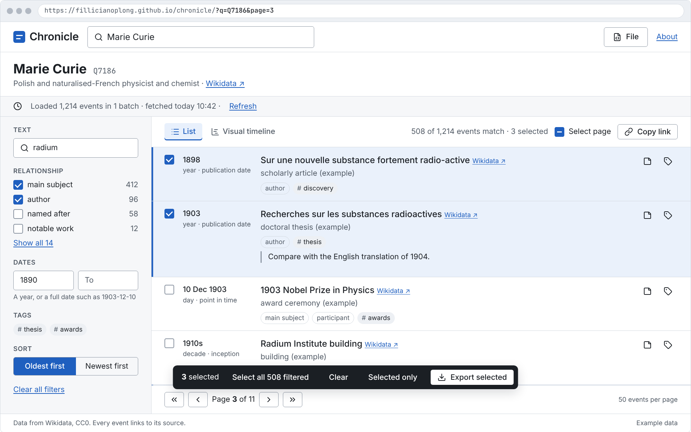

*Figure 1. Direction A, Plain record (chosen)*

**Purpose:** Compare looks on one screen.

**Assumption:** Same layout and data in all three.

**Limitation:** Only the list screen is drawn for B and C.

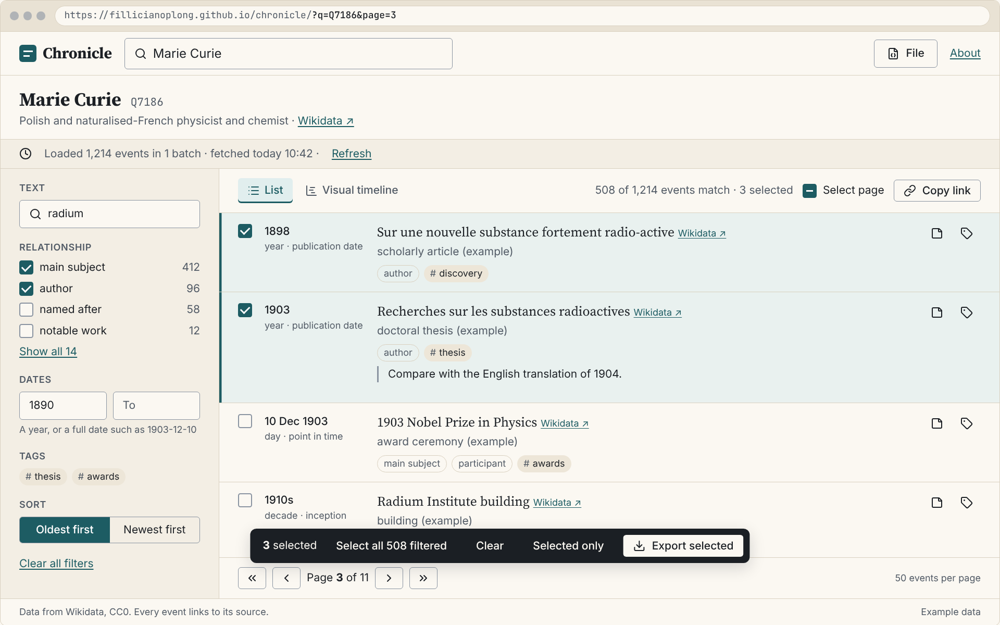

*Figure 2. Direction B, Archive*

**Purpose:** Compare looks on one screen.

**Assumption:** Same layout and data in all three.

**Limitation:** Only the list screen is drawn for B and C.

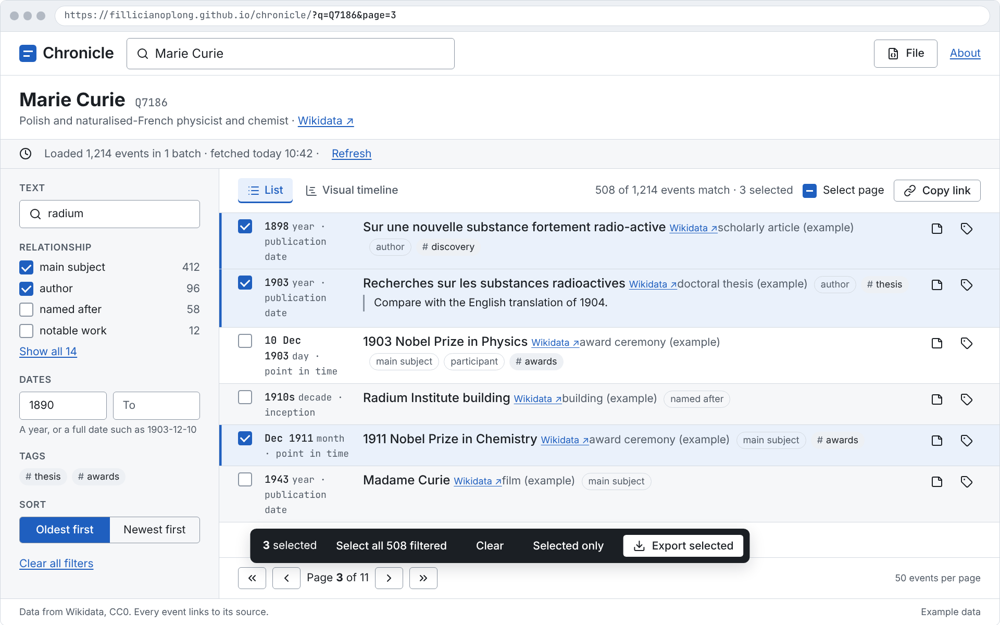

*Figure 3. Direction C, Ledger*

**Purpose:** Compare looks on one screen.

**Assumption:** Same layout and data in all three.

**Limitation:** Only the list screen is drawn for B and C.

## 3. Design tokens

All values live in one file, `docs/ui/tokens.css`, as CSS custom properties. Components use only these names. Dark values apply under `prefers-color-scheme: dark`.

### 3.1 Color

| Token | Use | Light | Dark |
|---|---|---|---|
| `c-bg` | Page background | #FFFFFF | #14171C |
| `c-surface` | Panels, header, filters | #F6F7F9 | #1B1F26 |
| `c-surface-2` | Hover, segmented control | #EDF0F4 | #252A33 |
| `c-border` | Dividers, card edges | #D3D9E0 | #3A414C |
| `c-border-strong` | Input and checkbox borders | #8A94A1 | #7D8794 |
| `c-text` | Body text | #1B1F24 | #E8EBEF |
| `c-text-muted` | Secondary text, dates' precision line | #525B66 | #A9B2BD |
| `c-accent` | Links, primary button, focus | #1F5FBF | #7EB0FF |
| `c-accent-hover` | Primary button hover | #184C99 | #A3C6FF |
| `c-on-accent` | Text on the primary button | #FFFFFF | #0D1B33 |
| `c-accent-soft` | Info banner, highlighted suggestion | #E8F0FC | #1D2B45 |
| `c-selected` | Selected row background | #EAF1FB | #1C2A40 |
| `c-success` | Complete loading | #1A7F37 | #5CC27D |
| `c-warning` | Warning text and icon | #7A5200 | #F0B44C |
| `c-warning-soft` | Warning banner background | #FFF4D6 | #3A2E12 |
| `c-danger` | Error text, delete action | #B42318 | #FF8A80 |
| `c-danger-soft` | Error banner background | #FDECEA | #3D1D1B |
| `c-tag` | Tag chip background | #EDF0F4 | #2B313B |

### 3.2 Contrast

Ratios are computed from `tokens.css` each time this document is built; the build fails if any pair drops below its target. Text needs 4.5:1; control edges and the focus ring need 3:1 (WCAG 2.2 1.4.3 and 1.4.11).

| Use | Pair | Target | Light | Dark |
|---|---|---|---|---|
| Body text | `c-text` on `c-bg` | 4.5:1 | 16.56 | 15.02 |
| Text on panels | `c-text` on `c-surface` | 4.5:1 | 15.45 | 13.82 |
| Secondary text | `c-text-muted` on `c-bg` | 4.5:1 | 6.89 | 8.37 |
| Secondary text on hover | `c-text-muted` on `c-surface-2` | 4.5:1 | 6.03 | 6.72 |
| Links | `c-accent` on `c-bg` | 4.5:1 | 6.09 | 8.16 |
| Primary button label | `c-on-accent` on `c-accent` | 4.5:1 | 6.09 | 7.81 |
| Selected row text | `c-text` on `c-selected` | 4.5:1 | 14.57 | 12.07 |
| Link in a selected row | `c-accent` on `c-selected` | 4.5:1 | 5.36 | 6.56 |
| Warning banner | `c-warning` on `c-warning-soft` | 4.5:1 | 6.32 | 7.18 |
| Error banner | `c-danger` on `c-danger-soft` | 4.5:1 | 5.75 | 6.62 |
| Delete action | `c-danger` on `c-bg` | 4.5:1 | 6.57 | 7.87 |
| Complete state | `c-success` on `c-bg` | 4.5:1 | 5.08 | 8.10 |
| Tag chip | `c-text` on `c-tag` | 4.5:1 | 14.49 | 10.94 |
| Input and checkbox edges | `c-border-strong` on `c-bg` | 3:1 | 3.07 | 4.93 |
| Focus ring | `c-focus` on `c-bg` | 3:1 | 6.09 | 8.16 |

### 3.3 Type

Production uses the system font stack: `system-ui, -apple-system, "Segoe UI", Roboto, "Noto Sans", sans-serif`. Numbers use tabular figures. The mockups render with Inter, a close match.

| Token | Size | Line height | Weight | Use |
|---|---|---|---|---|
| `fs-32` | 32 px | 1.25 | 650 | Home heading |
| `fs-24` | 24 px | 1.25 | 650 | Subject label |
| `fs-20` | 20 px | 1.25 | 650 | Section and dialog titles |
| `fs-16` | 16 px | 1.5 | 400 or 500 | Body, event titles, inputs |
| `fs-14` | 14 px | 1.5 | 400 or 500 | Descriptions, buttons, filters |
| `fs-12` | 12 px | 1.5 | 400 | Precision line, counts, chips, footer |

### 3.4 Spacing, shape, depth, motion

| Group | Values |
|---|---|
| Spacing (4 px base) | 4, 8, 12, 16, 24, 32, 48 px (`sp-1` to `sp-12`) |
| Radius | 4 px controls, 8 px cards and dialogs, pill for chips |
| Borders and focus | 1 px borders; focus ring 2 px with 2 px offset in `c-focus` |
| Elevation | `shadow-1` for cards; `shadow-2` for menus, drawer, dialogs, selection bar. None in dark mode for cards. |
| Layout | Header 56 px; filters 280 px; content up to 1200 px; row at least 64 px; targets at least 24 px, 44 px on touch |
| Motion | 120 ms and 200 ms; set to 0 under `prefers-reduced-motion` |
| Forced colors | Focus uses `Highlight`, links `LinkText`, borders `CanvasText` |

## 4. Layout and navigation

### 4.1 Screens and flow

| Screen | Path | Reached by |
|---|---|---|
| Home | `/chronicle/` | Opening the site; the brand link |
| Timeline | `/chronicle/?q=Q7186` | Picking a subject, a shared link, importing a file |
| About | `/chronicle/about/` | Header link; the "Why?" link on the too-broad screen |

The list and the visual timeline are two tabs of the Timeline screen, not separate pages. Menus, the drawer, and dialogs sit on top of the Timeline screen and do not change the URL, except that opening an event's link sets `event`.

### 4.2 State in the URL

Every view the user can share is in the URL (FR-71): `q`, `text`, `rel`, `from`, `to`, `sort`, `page`, `srel`, `sfrom`, `sto`, `view`, and `event`. Copy link copies it. Back and Forward restore earlier views (FR-77). Selection, notes, and tags are never in the URL.

### 4.3 Responsive behavior

| Width | Layout |
|---|---|
| 320 to 599 px | One column. Header shows the brand, a search icon button, and File. Filters open in a sheet from "Filters · n". Dates sit above titles. Selection bar spans the width. |
| 600 to 899 px | One column with wider rows; date column returns beside the title. Filters still in a sheet. |
| 900 to 1199 px | Filters panel (280 px) on the left, list on the right. |
| 1200 px and up | Content capped at 1200 px and centered. |

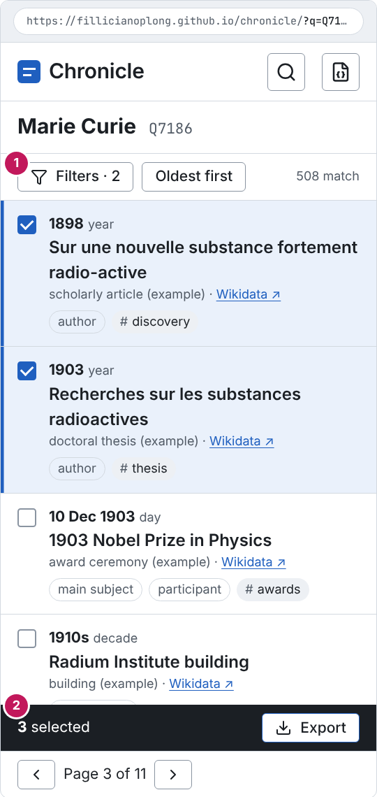

*Figure 4. Timeline list at 360 px, light*

**Purpose:** Show the small-screen layout.

**Assumption:** Same data as the desktop list.

**Limitation:** 320 px uses the same layout with tighter padding.

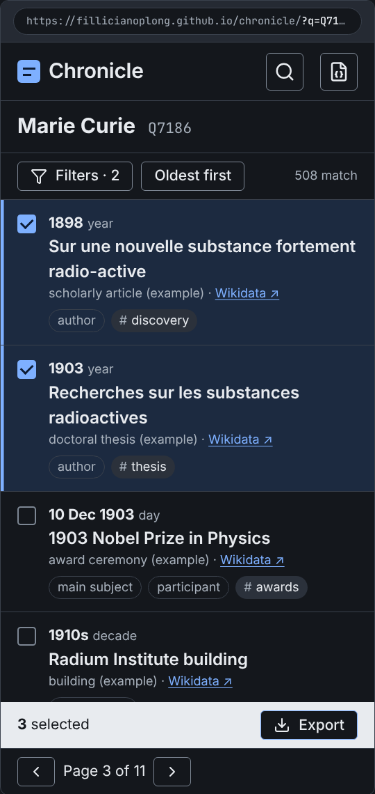

*Figure 5. Timeline list at 360 px, dark*

**Purpose:** Show the small-screen layout in dark mode.

**Assumption:** Same data as the light version.

**Limitation:** No callouts.

## 5. Components

Each component lists its states, how focus moves, and its accessibility notes. Every component has a visible focus ring.

| Component | States | Focus | Accessibility | SRS |
|---|---|---|---|---|
| Search box | Default, focus, typing, results open, no results, fallback results | Combobox. Arrow keys move the highlight; Enter opens the highlighted subject, or the top one if none is highlighted; Esc closes the list and keeps the text. | `role=combobox` with `aria-expanded` and `aria-activedescendant`; result count announced politely. | FR-01 to FR-04, FR-06, FR-09 to FR-11, FR-87 |
| Suggestion | Default, highlighted, hover | Not focusable itself; highlight follows the arrow keys. | `role=option`; label, description, and Q-ID read in that order. | FR-04 |
| Narrow before loading | Collapsed, open | Disclosure button; Tab moves into the relationship and date fields. | Native `details` and `summary`. | FR-07, FR-08 |
| Button | Primary, secondary, ghost, danger, icon-only; default, hover, active, focus, disabled | Tab stop; Enter and Space activate. | Icon-only buttons carry `aria-label`; at least 24 by 24 px, 44 px on touch. | NFR-38 |
| Subject header | Loaded, loading, cached | Wikidata link is a normal link. | `h1` is the subject label; Q-ID is plain text after it. | FR-53, FR-89, FR-97 |
| Loading bar | Running (indeterminate), paused, stopped, complete | Stop, Resume, and Retry are buttons in the bar; Stop keeps focus on Resume after it is pressed. | Status text in a polite live region, updated at most once per batch. | FR-29 to FR-34, FR-82 |
| Banner | Info, warning, error; with and without an action | Not focused on arrival unless it blocks the task (too broad); its action button is the next Tab stop. | Warning and error use `role=alert` once; an icon and a bold title so color is not the only signal. | FR-34, FR-37, FR-38, FR-83 to FR-85 |
| Filters panel | Default, with active filters, collapsed into a sheet below 900 px | Normal Tab order: text, relationships, dates, tags, sort, Clear all filters. | Each group is a `fieldset` with a `legend`; counts are part of each option's label. | FR-59 to FR-70, FR-116 |
| Relationship option | Unchecked, checked, too large | Checkbox; Space toggles. | Count read with the label, such as "author, 96 events". | FR-62, FR-69 |
| Segmented control | Two options, one pressed | Arrow keys move between options. | `radiogroup` with `radio` items. | FR-50 |
| View tabs | List, Visual timeline | Arrow keys switch tabs; Tab moves into the panel. | `tablist`, `tab`, `tabpanel`. | FR-78 |
| Event row | Default, hover, selected, focused, with note, with tags, label pending | The checkbox, the title link, the Wikidata link, and the note and tag buttons are Tab stops in that order. | `li` in a `ul`; selected rows show a check and a 3 px bar, not only a fill. | FR-17, FR-24, FR-45, FR-46, FR-48, FR-51, FR-52, FR-99 |
| Checkbox | Off, on, mixed (Select page), focus, disabled | Space toggles. | Native `input type=checkbox`; mixed uses `indeterminate`. | FR-99, FR-100 |
| Chip | Relationship, tag, removable tag | Removable tags have an x button with `aria-label` "Remove tag thesis". | Tag chips start with `#` so tags differ from relationships without color. | FR-115 |
| Pager | First, previous, page n of m, next, last; ends disabled | Buttons in a row; focus stays on the pressed button. | `nav` named "Pages"; the new page is announced. | FR-55 to FR-57, NFR-41 |
| Selection bar | Hidden, shown when one or more events are selected | Appears after the list in Tab order; it never takes focus on its own. | Count in a polite live region; buttons have text labels. | FR-101 to FR-103, FR-106, FR-113 |
| File menu | Closed, open | Menu button; arrow keys move, Enter picks, Esc closes and returns focus to File. | `menu` and `menuitem`; the delete item names its scope. | FR-90, FR-91, FR-106, FR-120 |
| Notes and tags drawer | Closed, open, saving, storage full | Opens with focus in the note field; Tab is kept inside; Esc or Cancel closes and returns focus to the row's note button. | Dialog with `aria-modal`; character count tied to the field with `aria-describedby`. | FR-114, FR-115, NFR-32, NFR-33 |
| Dialog | Confirm, alert | Focus goes to the safest button; Esc closes. | `alertdialog` for import errors and delete confirmation. | FR-96, FR-120 |
| Empty state | No events loaded, no events match | The single action is the next Tab stop. | Heading and one sentence; no illustration. | FR-67 |
| Footer | Always shown | Links in normal order. | States the CC0 source on every page. | FR-122, FR-124 |

### 5.1 Rules shared by all components

- All Wikidata, imported, and typed text is inserted as text, never as HTML (NFR-27).
- Color never carries meaning alone: selected rows have a check and a bar; too-large relationships have a text badge; banners have an icon and a title (NFR-39).
- Disabled controls stay readable and say why in a nearby line when the reason is not obvious.
- The first time an event is selected or a note is saved, an info banner says data stays in this browser and exporting is the safe copy (OD-24).

## 6. Icons

Icons come from Lucide (lucide-static 1.72.0, ISC license), copied as SVG into `docs/ui/icons/` with the license file. They are drawn at 16 px inside buttons and 20 px in banners, with a 2 px stroke in `currentColor`. Icons sit beside a text label; an icon-only button always has an accessible name.

| Icon | Used for |
|---|---|
| search | Search boxes |
| square-stop, play, rotate-cw | Stop, Resume, Retry and Refresh |
| download, upload, file-json | Export, Import, the File button |
| sticky-note, tag | Note and tags buttons |
| list, chart-gantt | List and Visual timeline tabs |
| external-link, link, copy | Wikidata links, Copy link |
| chevron-left/right, chevrons-left/right | Pager |
| zoom-in, zoom-out, maximize-2 | Visual timeline zoom and Fit all |
| triangle-alert, wifi-off, info, clock | Warning, offline, info, and cache banners |
| funnel, x, trash-2, loader-circle, square, square-check-big | Filters button, close, delete, spinner, checkbox art |

## 7. Screens

Each mockup includes the browser frame and URL. Pink numbered markers are callouts for this document only; they are not part of the design.

### 7.1 Home with suggestions

**Covers:** FR-01 to FR-07, FR-10, NFR-42. **Callouts:** 1 Search box, focused, with partial text; 2 Suggestions with a keyboard hint; 3 Narrow before loading (optional).

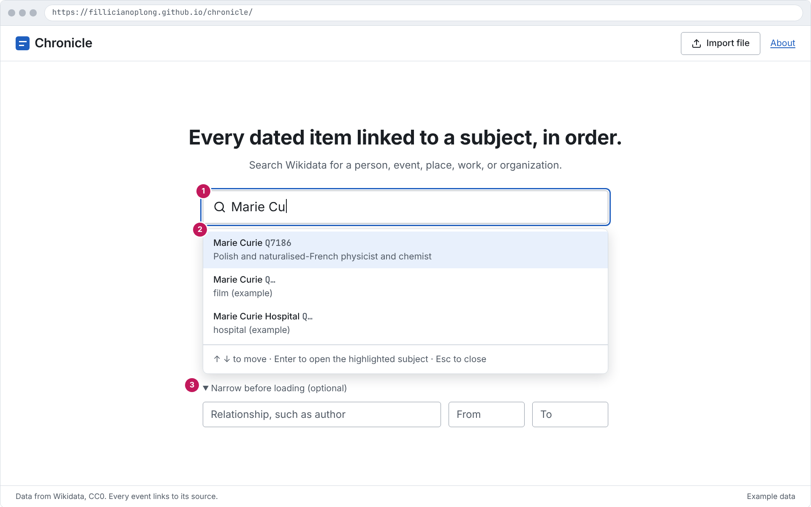

*Figure 6. Home with suggestions*

**Purpose:** Shows the first step: type, see suggestions with label, description, and Q-ID, then pick one.

**Assumption:** Example data; 1280 by 800 window.

**Limitation:** Static picture; motion and focus order are in *5. Components*.

### 7.2 No exact match, close matches

**Covers:** FR-09, FR-11. **Callouts:** 1 Misspelled text; 2 "No exact match. Close matches:" with a Q-ID tip.

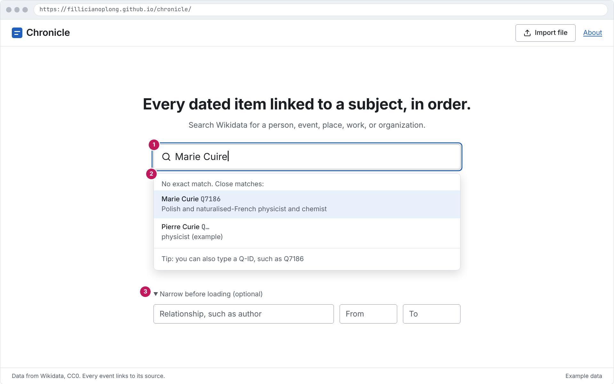

*Figure 7. No exact match, close matches*

**Purpose:** Shows the fuzzy fallback when the entity search finds nothing for a misspelled name.

**Assumption:** Example data; 1280 by 800 window.

**Limitation:** Static picture; motion and focus order are in *5. Components*.

### 7.3 No matching subject

**Covers:** FR-06. **Callouts:** 1 Text with no match; 2 Message from the error reference.

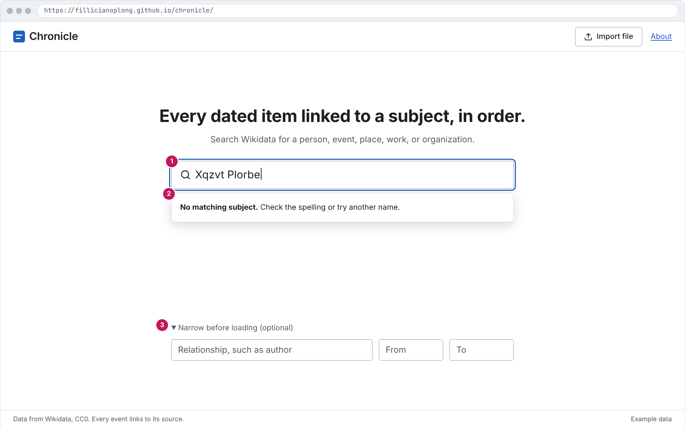

*Figure 8. No matching subject*

**Purpose:** Shows the message when both searches find nothing.

**Assumption:** Example data; 1280 by 800 window.

**Limitation:** Static picture; motion and focus order are in *5. Components*.

### 7.4 Loading with progress and Stop

**Covers:** FR-17, FR-29 to FR-31, FR-82. **Callouts:** 1 Indeterminate bar, events and batches so far, label progress; 2 Stop; 3 Row showing a Q-ID until its label arrives.

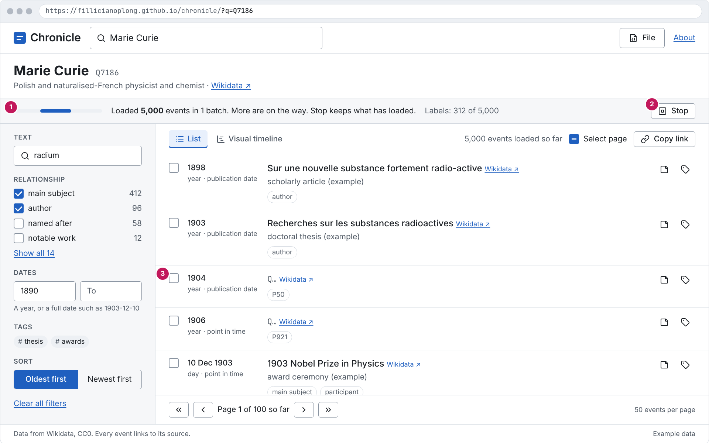

*Figure 9. Loading with progress and Stop*

**Purpose:** Shows the first batch on screen while later batches load, with labels still arriving.

**Assumption:** Example data; 1280 by 800 window.

**Limitation:** Static picture; motion and focus order are in *5. Components*.

### 7.5 Timeline list, desktop, light

**Covers:** FR-49 to FR-70, FR-75, FR-89, FR-99 to FR-106. **Callouts:** 1 Search box in the header; 2 File menu; 3 Subject header; 4 Cache line with Refresh; 5 Filters with counts; 6 List and Visual timeline tabs, counts, Select page, Copy link; 7 Event row with date at its precision; 8 Selection bar; 9 Pager, page 3 of 11, matching `page=3` in the URL.

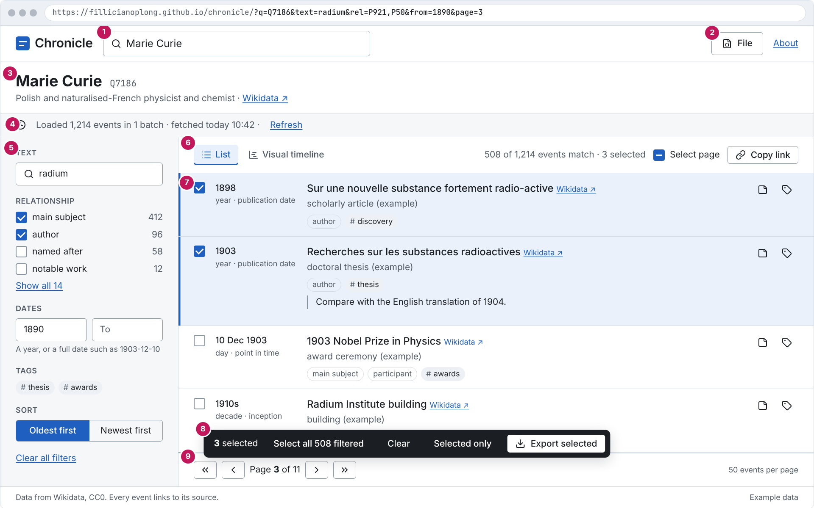

*Figure 10. Timeline list, desktop, light*

**Purpose:** The main working screen: header, subject, filters, list, selection, and paging.

**Assumption:** Example data; 1280 by 800 window.

**Limitation:** Static picture; motion and focus order are in *5. Components*.

### 7.6 Timeline list, desktop, dark

**Covers:** NFR-36. **Callouts:** No callouts; same layout as the light version above.

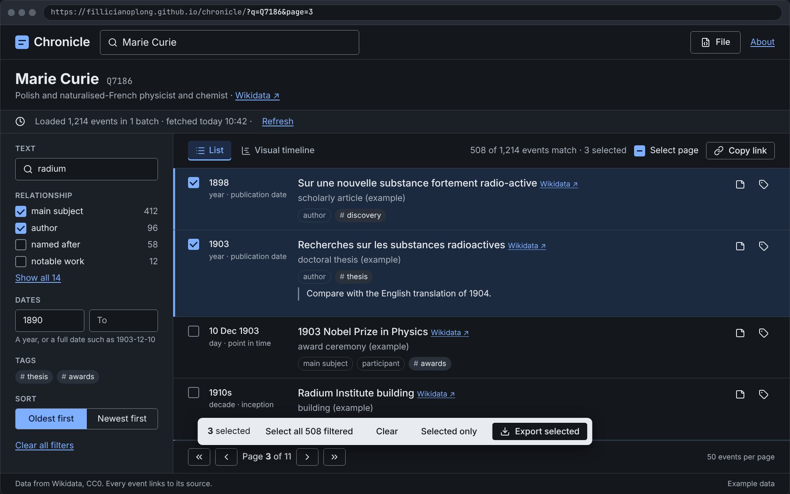

*Figure 11. Timeline list, desktop, dark*

**Purpose:** Same screen with the dark token set.

**Assumption:** Example data; 1280 by 800 window.

**Limitation:** Static picture; motion and focus order are in *5. Components*.

### 7.7 Subject too broad

**Covers:** FR-35 to FR-43. **Callouts:** 1 Warning banner; 2 Try again; 3 Relationship search with Load; 4 Too large to load, with a text badge; 5 Series panel with Stop and Resume per relationship.

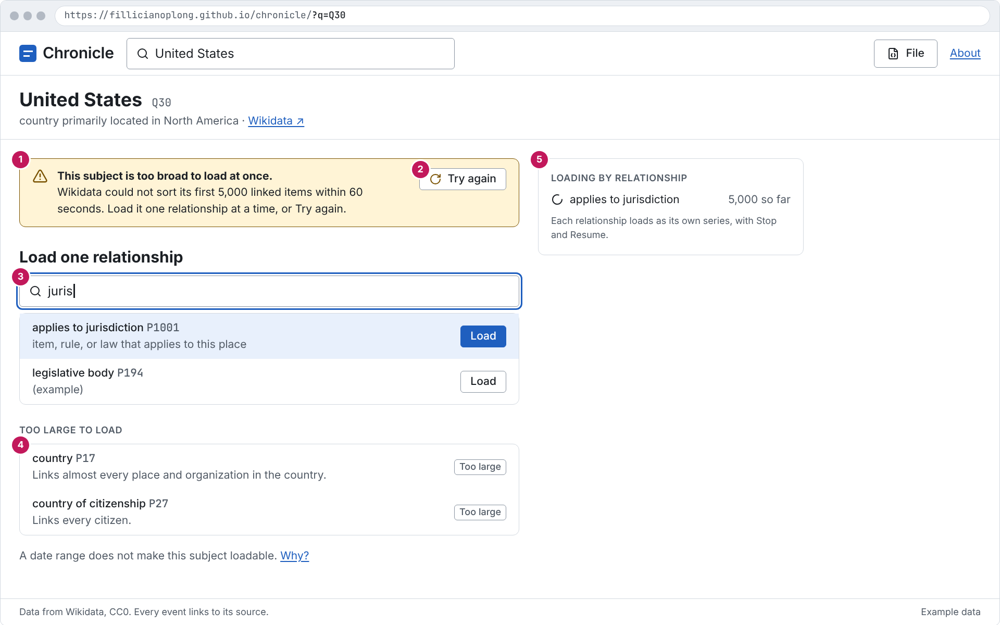

*Figure 12. Subject too broad*

**Purpose:** Shows how a very large subject is loaded one relationship at a time.

**Assumption:** Example data; 1280 by 800 window.

**Limitation:** Static picture; motion and focus order are in *5. Components*.

### 7.8 Visual timeline

**Covers:** FR-78 to FR-81. **Callouts:** 1 Zoom in, Zoom out, Fit all, keyboard hint; 2 Timeline with a selected item; 3 Details of the selected item.

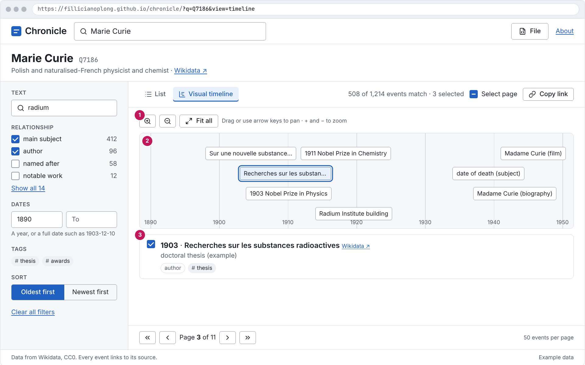

*Figure 13. Visual timeline*

**Purpose:** Shows the vis-timeline view of the filtered events and the details of the picked one.

**Assumption:** Example data; 1280 by 800 window.

**Limitation:** Static picture; motion and focus order are in *5. Components*.

### 7.9 Notes and tags drawer

**Covers:** FR-114, FR-115, FR-117, NFR-32, NFR-33. **Callouts:** 1 Note with counter 44 / 2,000; 2 Tags; 3 Storage-full warning that keeps the note on screen.

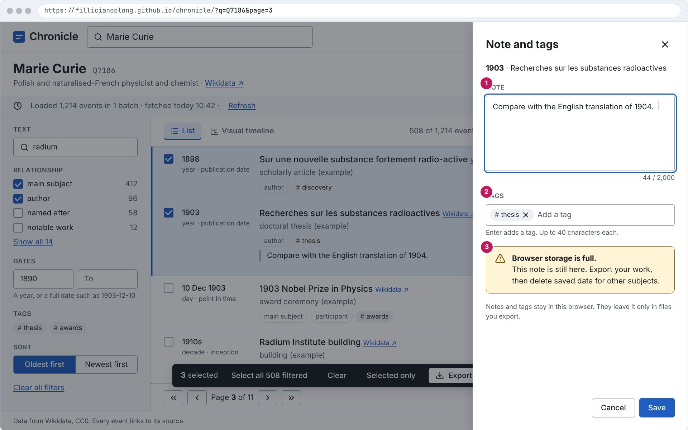

*Figure 14. Notes and tags drawer*

**Purpose:** Shows a note with its counter, tag chips, and the storage-full warning.

**Assumption:** Example data; 1280 by 800 window.

**Limitation:** Static picture; motion and focus order are in *5. Components*.

### 7.10 File menu

**Covers:** FR-90, FR-91, FR-106, FR-120. **Callouts:** 1 File menu open.

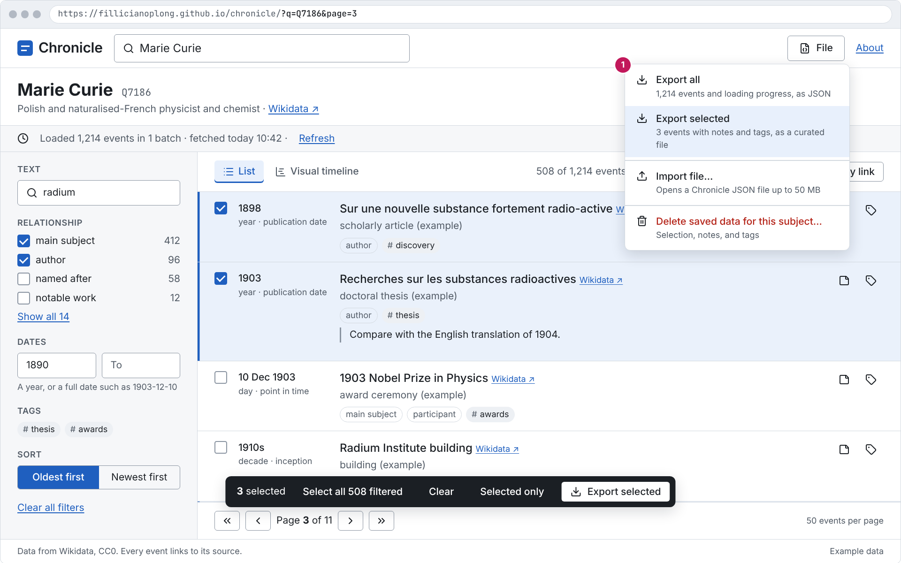

*Figure 15. File menu*

**Purpose:** Shows Export all, Export selected, Import, and Delete saved data.

**Assumption:** Example data; 1280 by 800 window.

**Limitation:** Static picture; motion and focus order are in *5. Components*.

### 7.11 Import rejected

**Covers:** FR-96, NFR-31. **Callouts:** 1 Alert dialog with the reason and file name.

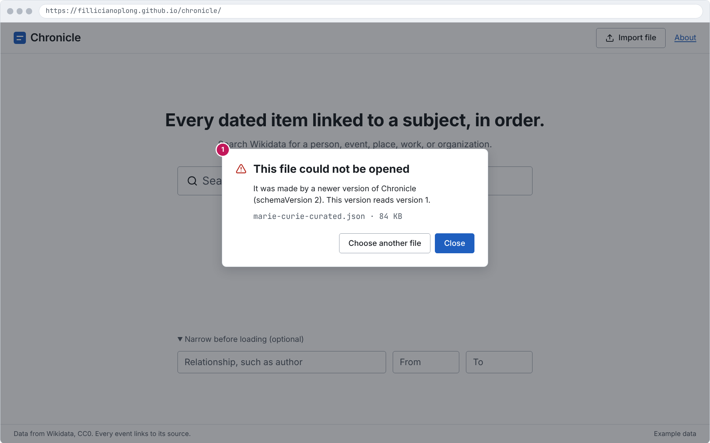

*Figure 16. Import rejected*

**Purpose:** Shows the alert dialog when a file has a newer schema version.

**Assumption:** Example data; 1280 by 800 window.

**Limitation:** Static picture; motion and focus order are in *5. Components*.

### 7.12 Errors while loading

**Covers:** FR-34, FR-83 to FR-85, NFR-15. **Callouts:** 1 Paused after an error, with Retry; 2 HTTP 429 countdown; 3 Offline.

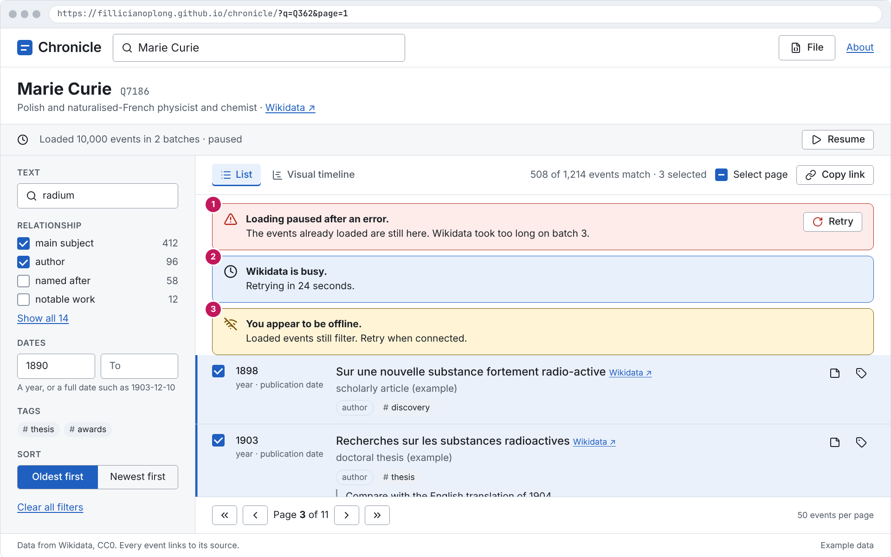

*Figure 17. Errors while loading*

**Purpose:** Shows a paused load, a busy service, and offline, with what still works.

**Assumption:** Example data; 1280 by 800 window.

**Limitation:** Static picture; motion and focus order are in *5. Components*.

### 7.13 No events match the filters

**Covers:** FR-67, FR-70. **Callouts:** 1 Empty state with Clear all filters.

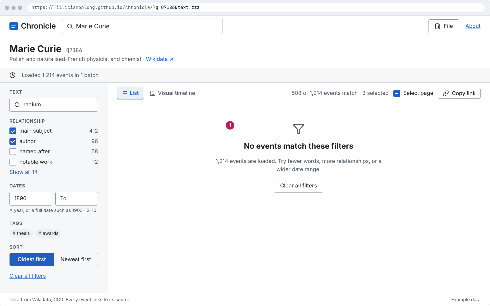

*Figure 18. No events match the filters*

**Purpose:** Shows the empty state with one way out.

**Assumption:** Example data; 1280 by 800 window.

**Limitation:** Static picture; motion and focus order are in *5. Components*.

## 8. Content and formatting

### 8.1 Dates

Dates show at the precision Wikidata records (FR-45, FR-46). The style is set by OD-28.

| Case | Shown as | Rule |
|---|---|---|
| Day precision | `10 Dec 1903` | Day number, three-letter month, year. No weekday. |
| Month precision | `Dec 1911` | Never invent a day. |
| Year precision | `1898` | Sorts before full dates in the same year (FR-47). |
| Decade, century, millennium | `1910s`, `19th century`, `2nd millennium` | Shown as recorded. |
| Before year 1 | `44 BCE`, `c. 3000 BCE` only if the source says circa | Year 0 does not exist; -0043 is 44 BCE. |
| Future dates | `2031` plus a text badge "Future" | Could (FR-48). |
| Precision line | `day · point in time` | Second line under every date: precision and date property (FR-24). |
| Counts | `1,214`, `5,000` | Comma thousands separator; numbers use tabular figures so columns line up. |
| Fetch time | `fetched today 10:42`, `fetched 12 Nov 2026 18:05` | Local time, 24-hour clock. |

### 8.2 Wording

- Error and status messages use the exact wording in the SRS *Error message reference*. A mockup may add one plain sentence of detail under the title.
- Wikidata labels and descriptions are shown unchanged, as plain text, never ranked or commented on (FR-123, NFR-27).
- Buttons are verbs: Stop, Resume, Retry, Try again, Export selected, Clear all filters.
- Sentence case everywhere. No exclamation marks.
- Every event shows a Wikidata link, so every event cites its source.
- The footer on every screen reads "Data from Wikidata, CC0. Every event links to its source." (FR-122).

## 9. Accessibility

Target: WCAG 2.2 level AA (NFR-36), with zero serious or critical axe violations in CI (NFR-37).

### 9.1 States scanned by axe

- Home: empty, with suggestions open, no results, fallback results
- Timeline list: loading, complete, paused with error, offline, cached with Refresh
- Timeline list: with selection bar, with Selected only on, with filters giving no results
- Too broad: banner, relationship results, series panel
- Visual timeline: default and with a selected item
- Notes and tags drawer: open, with storage-full warning
- File menu open; import error dialog; delete confirmation dialog
- About page
- Each of the above at 320 px and 1280 px, light and dark

### 9.2 Keyboard

| Key | Action |
|---|---|
| Tab, Shift+Tab | Move between controls in reading order |
| / | Focus the search box, when focus is not in a text field |
| Arrow Up, Arrow Down | Move through suggestions, menus, and the relationship list |
| Enter | Open the highlighted subject (or the top one); activate a button |
| Esc | Close suggestions, menu, drawer, or dialog, and return focus |
| Space | Toggle a checkbox |
| Arrow Left, Arrow Right | Switch tabs and segmented options; pan the visual timeline |
| +, - | Zoom the visual timeline in and out |

### 9.3 Live regions and focus

- Polite: result count after a filter change, the new page number, loading progress once per batch, selected count.
- Assertive, once: too broad, paused after an error, offline.
- After picking a subject, focus moves to the subject heading. After a page change, focus moves to the first row.
- Menus, the drawer, and dialogs return focus to the control that opened them.
- A "Skip to results" link is the first Tab stop on the Timeline screen.

### 9.4 Other checks

- Targets at least 24 by 24 px (WCAG 2.2 2.5.8); 44 px on touch layouts.
- No horizontal scrolling from 320 to 1920 px (NFR-40); text can be enlarged to 200%.
- Reduced motion removes transitions and the indeterminate bar's motion; the bar text still updates.
- Forced colors mode keeps borders, focus, and the selected bar visible.
- The visual timeline has a text alternative: the list tab holds the same events, and the details panel reads the selected item.

## 10. Candidate UI issues

These become GitHub issues in the implementation plan. Each has one Given / When / Then check; the plan may split them.

| ID | Title | Acceptance | SRS |
|---|---|---|---|
| UI-01 | Design tokens and base styles | Given the app loads, when any screen renders, then every color, size, and space comes from `tokens.css`, and light and dark follow the system setting. | NFR-36, NFR-39 |
| UI-02 | Search box and suggestions | Given the home page, when the user types "Marie Cu" and pauses, then suggestions show label, description, and Q-ID; and when the user presses Enter, then the top suggestion opens. | FR-01 to FR-04, FR-10, FR-87 |
| UI-03 | Fallback and no-result messages | Given a name with a typo, when the entity search finds nothing, then close matches appear under "No exact match"; and when both find nothing, then the no-subject message appears. | FR-06, FR-09, FR-11 |
| UI-04 | Loading bar with Stop and Resume | Given a subject is loading, when each batch arrives, then the bar text shows events and batches so far; and when the user presses Stop, then loading ends, events stay, and Resume appears. | FR-29 to FR-32, FR-82 |
| UI-05 | Event row | Given a loaded event, when it renders, then it shows the date at its recorded precision, the precision and date property, label or Q-ID, description, relationships, and a Wikidata link. | FR-17, FR-24, FR-45, FR-46, FR-51, FR-52 |
| UI-06 | Pager and page in the URL | Given 508 filtered events, when the user opens page 3, then rows 101 to 150 show, the URL has `page=3`, and the page change is announced. | FR-55 to FR-58, FR-71, NFR-41 |
| UI-07 | Filters panel and mobile sheet | Given a timeline, when the user checks a relationship, then its count is shown and the list updates; and below 900 px, filters open in a sheet from a "Filters · n" button. | FR-59 to FR-70, NFR-40 |
| UI-08 | Too-broad screen | Given a subject whose first batch times out, when the banner shows, then Try again and relationship search are offered, and P17 and P27 are marked "Too large" in text. | FR-35 to FR-43, NFR-39 |
| UI-09 | Selection and selection bar | Given three selected events, when the user changes page or filters, then the bar still reads "3 selected" and Export selected writes those three. | FR-99 to FR-108, FR-113 |
| UI-10 | Notes and tags drawer | Given an event, when the user opens its note, then focus moves to the note field, the counter shows n / 2,000, and Esc returns focus to the note button. | FR-114, FR-115, NFR-32, NFR-33 |
| UI-11 | File menu, import, and errors | Given a file with a newer schema version, when the user imports it, then an alert dialog names the reason and the current timeline is unchanged. | FR-90 to FR-97, FR-120 |
| UI-12 | Error banners | Given an HTTP 429 with Retry-After 24, when it happens, then the banner reads "Wikidata is busy. Retrying in 24 seconds." and counts down. | FR-34, FR-83 to FR-85 |
| UI-13 | Visual timeline view | Given the Visual timeline tab, when the user presses + and the arrow keys, then the view zooms and pans, and selecting an item shows its details below. | FR-78 to FR-81 |
| UI-14 | Accessibility checks in CI | Given each state in the axe list, when the end-to-end suite runs, then axe reports zero serious or critical violations at 320 and 1280 px, light and dark. | NFR-36 to NFR-38, NFR-40 |

## 11. Design decisions

All UI design decisions are settled; none is open. The mockups follow these decisions.

| ID | Question | Decision | Status |
|---|---|---|---|
| OD-26 | Which visual direction? | A, "Plain record": system sans serif, white and blue, roomy rows. | Decided, Nov 13, 2026 |
| OD-27 | Theme switch or follow the system? | Follow the system setting; no toggle in v1. | Decided, Nov 13, 2026 |
| OD-28 | Date format? | `10 Dec 1903`, `Dec 1911`, `1898`, `1910s`, `19th century`, `44 BCE`. | Decided, Nov 13, 2026 |
| OD-29 | Fonts? | System font stack; no web font download (fits the CSP and NFR-08). | Decided, Nov 13, 2026 |
| OD-30 | Where are notes and tags edited? | A side drawer on desktop, a full-screen sheet on phones. | Decided, Nov 13, 2026 |
| OD-31 | Where do selection actions live? | A floating bar at the bottom of the list, shown only when something is selected. | Decided, Nov 13, 2026 |
| OD-32 | How do filters fit on small screens? | Below 900 px, a "Filters · n" button opens them in a sheet. | Decided, Nov 13, 2026 |
| OD-33 | Which layout for the timeline screen? | The original direction A layout: filters panel on the left, List and Visual timeline tabs, floating selection bar. Four other layouts were explored and not chosen (see *2. Visual direction*). | Decided, Nov 13, 2026 |

## 12. Maintenance and sources

Change `docs/ui/tokens.css` first, then run `python3 docs/ui/build_mockups.py` to redraw the mockups and `python3 docs/generate_ui.py` to rebuild this document. Never edit the .docx by hand.

| File | Contents |
|---|---|
| `docs/ui/tokens.css` | Design tokens, light and dark |
| `docs/ui/app.css` | Component styles used by the mockups |
| `docs/ui/build_mockups.py` | Mockup HTML and PNG rendering |
| `docs/ui/mockups/*.html` | Mockup sources |
| `docs/ui/icons/` | Lucide SVG icons and license |
| `docs/images/ui-*.png` | Rendered mockups |
| `docs/ui/explored/` | Layouts explored and not chosen, with their sources and notes |

| Reference | Used for |
|---|---|
| Chronicle SRS version 1.4 (`docs/SRS.md`) | Every FR, NFR, and OD up to OD-19 |
| Chronicle Architecture version 1.1 (`docs/ARCHITECTURE.md`) | Screens, URL state, CSP, OD-20 to OD-25 |
| WCAG 2.2 (w3.org/TR/WCAG22) | Contrast, target size, focus |
| WAI-ARIA Authoring Practices (w3.org/WAI/ARIA/apg) | Combobox, menu, tabs, dialog patterns |
| axe-core rules (github.com/dequelabs/axe-core) | CI accessibility checks |
| Lucide (lucide.dev), ISC license | Icons |
| vis-timeline (github.com/visjs/vis-timeline) | Visual timeline view |
