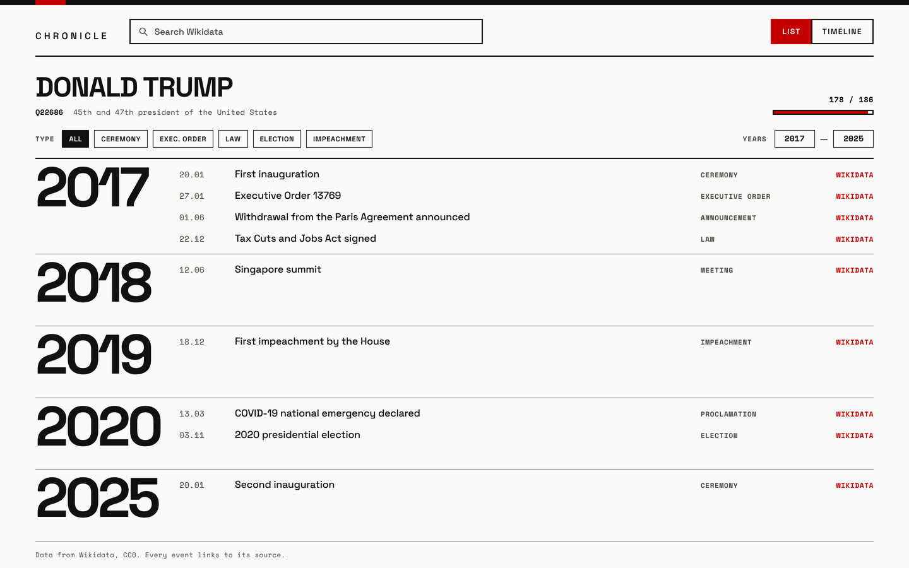
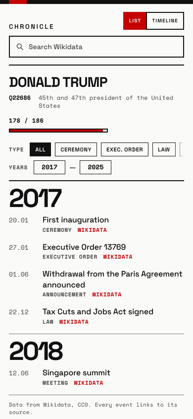
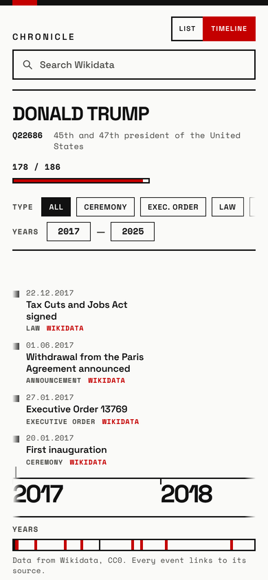
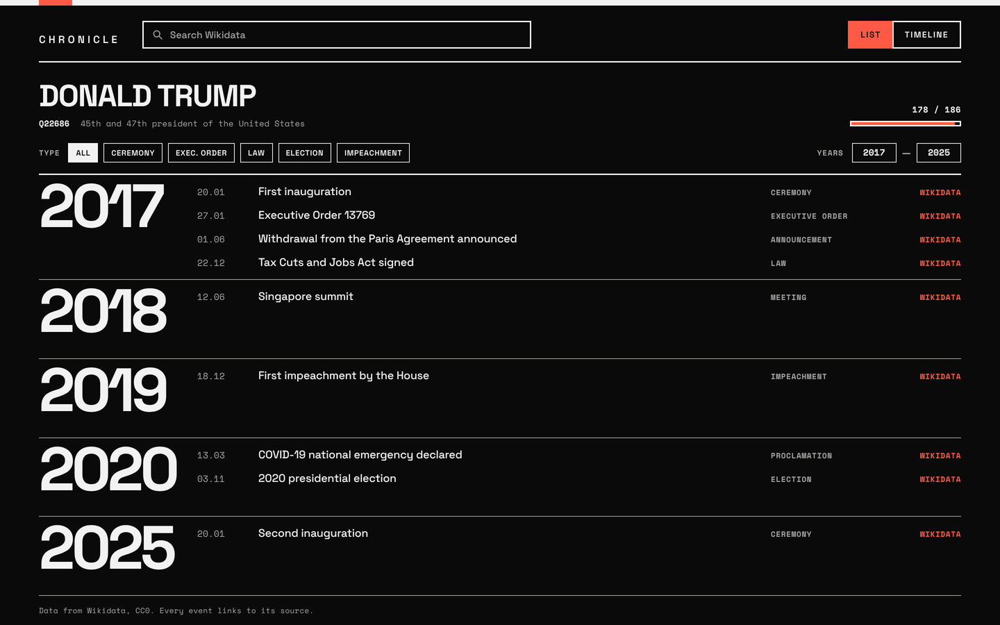
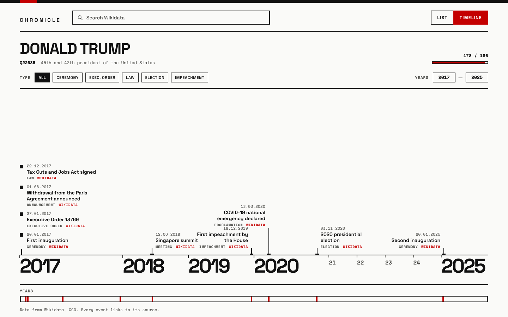
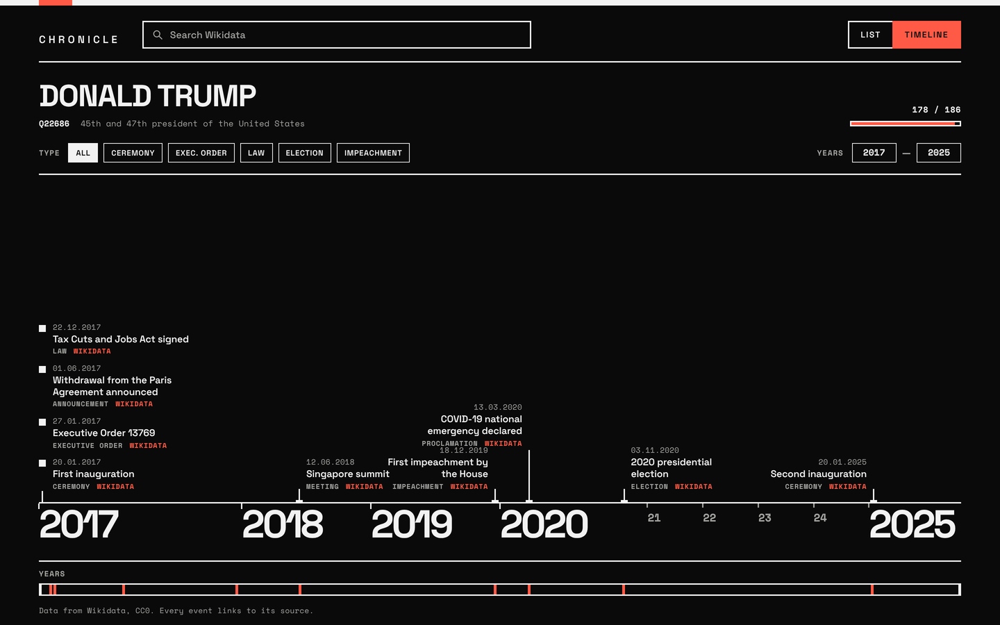
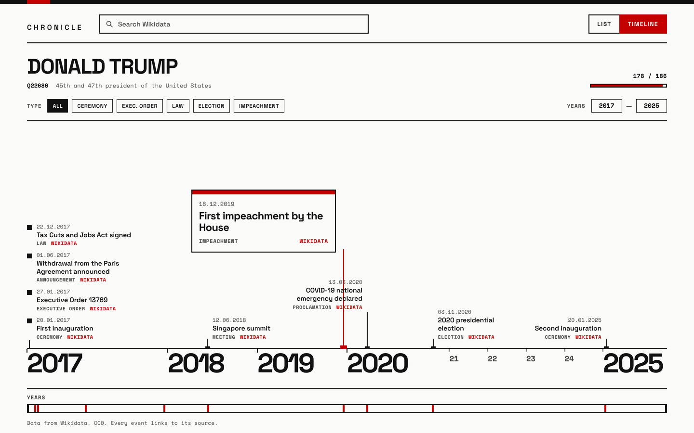
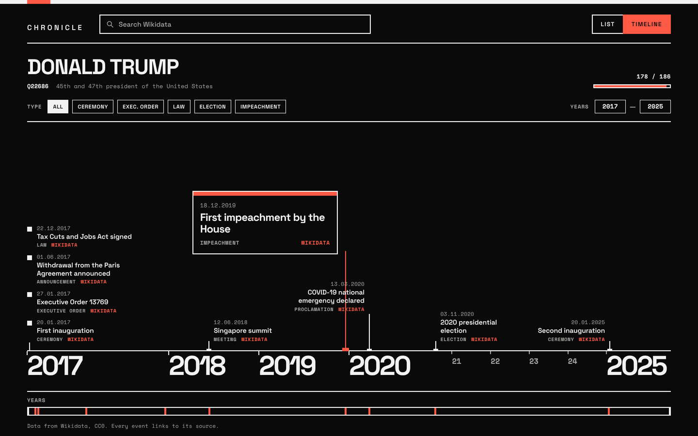
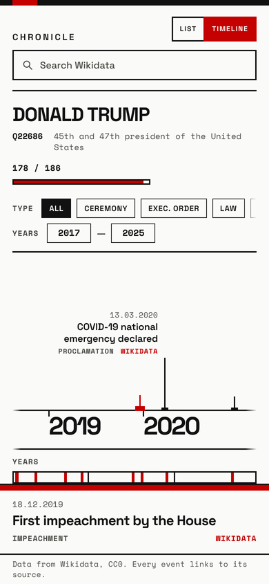

# Chronicle v1: UI Design Document

How Chronicle looks, reads, and responds  
Prepared by Filliciano Plong  
November 20, 2026  
Version 1.3  

## Contents

- [Revision history](#revision-history)
- [1. Purpose and readers](#1-purpose-and-readers)
- [2. Visual direction](#2-visual-direction)
- [3. Design tokens](#3-design-tokens)
- [4. Layout and navigation](#4-layout-and-navigation)
- [5. Components](#5-components)
- [6. Icons](#6-icons)
- [7. Screens](#7-screens)
- [8. Content and formatting](#8-content-and-formatting)
- [9. Accessibility](#9-accessibility)
- [10. Candidate UI issues](#10-candidate-ui-issues)
- [11. Design decisions](#11-design-decisions)
- [12. Maintenance and sources](#12-maintenance-and-sources)

## Revision history

| Version | Date | Changes |
|---|---|---|
| 1.0 | November 13, 2026 | First release, based on the Chronicle SRS version 1.4 and Architecture version 1.1. |
| 1.1 | November 13, 2026 | Recorded OD-26 to OD-32 as decided and added OD-33: the original direction A layout is kept. Four other layouts were explored and not chosen; they are kept in docs/ui/explored/. |
| 1.2 | November 20, 2026 | Candidate UI items are tracked as Jira stories when that work starts. |
| 1.3 | November 20, 2026 | Locked in the Plakat direction, with both a list view and a timeline view. The timeline opens with no event selected. Tokens, contrast, typography, layout, and screens were updated to match. |

## 1. Purpose and readers

**Readers:** Filliciano Plong, to build the Chronicle screens; reviewers, to check that the design meets the SRS.

This document sets how Chronicle looks and behaves on screen: layout, color, type, spacing, icons, components, and every key screen and state. What the system must do is in the Chronicle SRS version 1.5; how it is built is in the Architecture document version 1.2. This document cites both by ID instead of repeating them.

The mockups are drawn in HTML from the same token file the app will use, then saved as PNG. The Plakat mockups use example events for Donald Trump (Q22686) to show the list and the timeline. Event titles are illustrative; every event still cites Wikidata as its source.

| Design aim | What it means on screen |
|---|---|
| Plain and neutral | Wikidata text shown as is. No ranking, ratings, or decoration that suggests a view (FR-123). |
| Source on every line | Each event links to its Wikidata item; the footer states the CC0 source (FR-52, FR-122). |
| Fast to a timeline | Type, pick, view: three steps (NFR-42). |
| Honest about loading | Show what has loaded, what is still loading, and what failed (FR-30, FR-34). |
| Usable by everyone | WCAG 2.2 AA, keyboard only, 320 to 1920 px (NFR-36 to NFR-40). |

## 2. Visual direction

The locked-in look is Plakat (OD-34): a Swiss poster style with a strict grid, sharp corners, hard black rules, oversized year numerals as the main art, and one signal red. Type is self-hosted Space Grotesk for titles and Space Mono for dates, codes, and labels. The product has two views of the same events, switched by a List / Timeline toggle in the header.

Earlier rounds compared other looks and layouts, including a plain record with a system sans serif, an archive serif, a compact ledger, an editorial gallery, a horizontal Horizon timeline, and a year-by-month grid. Those drafts are not the product direction. OD-26, OD-29, and OD-33, which chose the earlier direction and layout, are superseded by OD-34.

| Direction | Look | Role |
|---|---|---|
| Plakat (chosen) | Space Grotesk and Space Mono; paper white and ink, one signal red; giant year numerals; sharp corners and 2 px rules | The product direction for the list and the timeline |
| Earlier alternatives | Plain record, archive, ledger, and later layout studies such as a horizontal card timeline and a year-month grid | Not chosen; kept only as a record of the comparison |

*Figure 1. Plakat list, desktop, light (chosen)*

**Purpose:** Show the locked-in list view.

**Assumption:** Example events for Donald Trump (Q22686); 1440 by 900 window.

**Limitation:** Static picture; the Timeline view is in *7. Screens*.

## 3. Design tokens

All values live in one file, `docs/ui/tokens.css`, as CSS custom properties. Components use only these names. Dark values apply under `prefers-color-scheme: dark`.

### 3.1 Color

| Token | Use | Light | Dark |
|---|---|---|---|
| `c-bg` | Page background | #FAFAF8 | #0A0A0A |
| `c-surface` | Panels, header, filters | #FAFAF8 | #0A0A0A |
| `c-surface-2` | Hover, segmented control | #F0F0EC | #161616 |
| `c-border` | Dividers, card edges | #767672 | #A3A3A0 |
| `c-border-strong` | Input and checkbox borders | #111111 | #F2F2F2 |
| `c-text` | Body text | #111111 | #F2F2F2 |
| `c-text-muted` | Secondary text, dates' precision line | #4A4A46 | #A3A3A0 |
| `c-accent` | Links, primary button, focus | #C40000 | #FF5A45 |
| `c-accent-hover` | Primary button hover | #9B0000 | #FF7A68 |
| `c-on-accent` | Text on the primary button | #FFFFFF | #0A0A0A |
| `c-accent-soft` | Info banner, highlighted suggestion | #F8E8E6 | #1A1210 |
| `c-selected` | Selected row background | #F3EDED | #1A1210 |
| `c-success` | Complete loading | #1A7F37 | #5CC27D |
| `c-warning` | Warning text and icon | #7A5200 | #F0B44C |
| `c-warning-soft` | Warning banner background | #FFF4D6 | #3A2E12 |
| `c-danger` | Error text, delete action | #C40000 | #FF5A45 |
| `c-danger-soft` | Error banner background | #F8E4E0 | #3A1614 |
| `c-tag` | Tag chip background | #F0F0EC | #161616 |

### 3.2 Contrast

Ratios are computed from `tokens.css` each time this document is built; the build fails if any pair drops below its target. Text needs 4.5:1; control edges and the focus ring need 3:1 (WCAG 2.2 1.4.3 and 1.4.11). In dark mode, labels on the signal red use `c-on-accent` (#0A0A0A). White on that red (#FF5A45) is only 3.1:1 and must not be used.

| Use | Pair | Target | Light | Dark |
|---|---|---|---|---|
| Body text | `c-text` on `c-bg` | 4.5:1 | 18.07 | 17.68 |
| Text on panels | `c-text` on `c-surface` | 4.5:1 | 18.07 | 17.68 |
| Secondary text | `c-text-muted` on `c-bg` | 4.5:1 | 8.52 | 7.83 |
| Secondary text on hover | `c-text-muted` on `c-surface-2` | 4.5:1 | 7.79 | 7.16 |
| Links | `c-accent` on `c-bg` | 4.5:1 | 6.00 | 6.41 |
| Primary button label | `c-on-accent` on `c-accent` | 4.5:1 | 6.27 | 6.41 |
| Selected row text | `c-text` on `c-selected` | 4.5:1 | 16.32 | 16.48 |
| Link in a selected row | `c-accent` on `c-selected` | 4.5:1 | 5.42 | 5.98 |
| Warning banner | `c-warning` on `c-warning-soft` | 4.5:1 | 6.32 | 7.18 |
| Error banner | `c-danger` on `c-danger-soft` | 4.5:1 | 5.13 | 5.21 |
| Delete action | `c-danger` on `c-bg` | 4.5:1 | 6.00 | 6.41 |
| Complete state | `c-success` on `c-bg` | 4.5:1 | 4.86 | 8.93 |
| Tag chip | `c-text` on `c-tag` | 4.5:1 | 16.53 | 16.16 |
| Input and checkbox edges | `c-border-strong` on `c-bg` | 3:1 | 18.07 | 17.68 |
| Focus ring | `c-focus` on `c-bg` | 3:1 | 18.07 | 17.68 |

### 3.3 Type

Production uses self-hosted Space Grotesk for titles and Space Mono for dates, Q-IDs, type labels, and the footer. Both families are SIL Open Font License 1.1, served from the site so no third-party font request is made (NFR-08, CSP). Numbers use tabular figures. The system stack is the fallback only.

| Token | Size | Line height | Weight | Use |
|---|---|---|---|---|
| Wordmark | 15 px | 1 | 600 | CHRONICLE, uppercase, wide tracking |
| `fs-44` | 44 px (28 px on small screens) | 0.95 | 700 | Subject name, uppercase |
| Year, list | 88 px (52 px on small screens) | 0.8 | 700 | Year group numerals in the list |
| Year, timeline | 56 px (36 px on small screens) | 0.8 | 700 | Year numerals along the timeline axis |
| `fs-16` | 16 px | 1.35 | 500 or 600 | Event titles, inputs |
| `fs-14` | 14 px | 1.35 | 500 or 600 | Buttons, compact titles |
| Mono 12-13 | 12 or 13 px | 1.35 | 400 or 700 | Dates, Q-IDs, year fields, progress |
| Mono 10-11 | 10 or 11 px | 1.35 | 700 | Type labels, Wikidata links, chips, footer |

### 3.4 Spacing, shape, depth, motion

| Group | Values |
|---|---|
| Spacing (4 px base) | 4, 8, 12, 16, 24, 32, 48 px (`sp-1` to `sp-12`); page padding 56 px, 18 px on small screens |
| Radius | 0. Every corner is sharp, including chips, the search box, and the view toggle. |
| Borders and focus | 2 px ink rules for the header, search, toggle, and year fields; 1 px for chips and hairlines; an 8 px ink top rule with a 48 px signal-red tick. Focus ring 2 px in `c-focus` with a 2 px offset. |
| Elevation | None. Menus and dialogs use a 2 px ink border, not a drop shadow. |
| Signal red | Used sparingly: the top-rule tick, the pressed view toggle, the loading bar, Wikidata links, and, after an event is chosen, the timeline stem and details slab. |
| Layout | Full width with page padding; no 1200 px cap and no left-hand filters column. Targets at least 24 px, 44 px on touch. |
| Motion | 120 ms and 200 ms; set to 0 under `prefers-reduced-motion` |
| Forced colors | Focus uses `Highlight`, links `LinkText`, borders `CanvasText` |

## 4. Layout and navigation

### 4.1 Screens and flow

| Screen | Path | Reached by |
|---|---|---|
| Home | `/chronicle/` | Opening the site; the brand link |
| Timeline | `/chronicle/?q=Q22686` | Picking a subject, a shared link, importing a file |
| About | `/chronicle/about/` | Header link; the "Why?" link on the too-broad screen |

The list and the timeline are two views of the same Timeline screen, switched by the List / Timeline toggle in the header, not separate pages (FR-78). Menus, the drawer, and dialogs sit on top of this screen and do not change the URL, except that choosing an event may set `event`.

### 4.2 State in the URL

Every view the user can share is in the URL (FR-71): `q`, `text`, `rel`, `from`, `to`, `sort`, `page`, `srel`, `sfrom`, `sto`, `view`, and `event`. `view` is `list` or `timeline`. `event` is omitted until an event is chosen. Copy link copies the URL. Back and Forward restore earlier views (FR-77). Notes, tags, and multi-select for export are never in the URL.

### 4.3 Responsive behavior

| Width | Layout |
|---|---|
| 320 to 699 px | One column, 18 px padding. Header: brand and the view toggle on the first row, search on the second. The subject name stacks above the progress bar. Type chips scroll sideways; the year range sits on the next row. In the list, the year numeral sits above its events. In the timeline, the axis is swiped sideways and a year scrubber stays at the bottom; a chosen event opens as a full-width details slab under the scrubber. |
| 700 px and up | Full Plakat grid, 56 px padding. Header: brand, search, and the view toggle on one row. Subject and progress sit side by side. Filters and the year range share one bar. The list uses a year column on the left. The timeline uses a horizontal axis with year numerals below it and a year scrubber under that. |

*Figure 2. Plakat list at 390 px, light*

**Purpose:** Show the small-screen list layout.

**Assumption:** Same subject and events as the desktop list.

**Limitation:** Type chips scroll; the year range is on the next row.

*Figure 3. Plakat timeline at 390 px, light, nothing selected*

**Purpose:** Show the small-screen timeline at first open, with no event selected.

**Assumption:** Same subject and events; the axis starts at the earliest year.

**Limitation:** Later years are off to the right and are reached by swiping.

## 5. Components

Each component lists its states, how focus moves, and its accessibility notes. Every component has a visible focus ring.

| Component | States | Focus | Accessibility | SRS |
|---|---|---|---|---|
| Search box | Default, focus, typing, results open, no results, fallback results | Combobox. Arrow keys move the highlight; Enter opens the highlighted subject, or the top one if none is highlighted; Esc closes the list and keeps the text. | `role=combobox` with `aria-expanded` and `aria-activedescendant`; result count announced politely. | FR-01 to FR-04, FR-06, FR-09 to FR-11, FR-87 |
| Suggestion | Default, highlighted, hover | Not focusable itself; highlight follows the arrow keys. | `role=option`; label, description, and Q-ID read in that order. | FR-04 |
| Narrow before loading | Collapsed, open | Disclosure button; Tab moves into the relationship and date fields. | Native `details` and `summary`. | FR-07, FR-08 |
| Button | Primary, secondary, ghost, danger, icon-only; default, hover, active, focus, disabled | Tab stop; Enter and Space activate. | Icon-only buttons carry `aria-label`; at least 24 by 24 px, 44 px on touch. | NFR-38 |
| Subject header | Loaded, loading, cached | Wikidata link is a normal link. | `h1` is the subject label; Q-ID is plain text after it. | FR-53, FR-89, FR-97 |
| Loading bar | Running (indeterminate), paused, stopped, complete | Stop, Resume, and Retry are buttons in the bar; Stop keeps focus on Resume after it is pressed. | Status text in a polite live region, updated at most once per batch. | FR-29 to FR-34, FR-82 |
| Banner | Info, warning, error; with and without an action | Not focused on arrival unless it blocks the task (too broad); its action button is the next Tab stop. | Warning and error use `role=alert` once; an icon and a bold title so color is not the only signal. | FR-34, FR-37, FR-38, FR-83 to FR-85 |
| Filter bar | Default, with a type chip pressed, year range set | Tab order: type chips, then the year range fields. On small screens the chips scroll sideways. | The pressed type chip is inverted ink, not red, so red stays the signal for the view toggle, links, and a chosen event. If more filters are added later (relationships, tags, text), they join this bar or open in a sheet (OD-32). | FR-59 to FR-70, FR-116 |
| Relationship option | Unchecked, checked, too large | Checkbox; Space toggles. | Count read with the label, such as "author, 96 events". | FR-62, FR-69 |
| Segmented control | Two options, one pressed | Arrow keys move between options. | `radiogroup` with `radio` items. | FR-50 |
| View toggle | List pressed, Timeline pressed | Two toggle buttons in a group; arrow keys move between them; Tab moves into the active view. | `radiogroup` (or `tablist`) with one option pressed; the pressed option uses signal red with `c-on-accent` text. | FR-78 |
| Timeline axis | Default (nothing selected), a marker focused, a marker chosen | Arrow Left and Arrow Right move between events; Home and End jump to the first and last; Enter or Space chooses the focused event, or clears it if it is already chosen; Esc clears the choice. A focus ring may appear on the focused marker; that is keyboard focus, not a choice. | The axis is a region named "Timeline". Each marker is a button whose name is the date and title. Nothing is chosen when the view first opens. | FR-78 to FR-81 |
| Details slab | Hidden, shown after an event is chosen | Appears after the event is activated. Tab can move into the Wikidata link. Esc hides the slab and returns focus to the marker. | The slab has an 8 px signal-red top rule and a matching stem to a red square on the axis. On small screens it is a full-width block under the year scrubber. It is not shown until a click or keyboard activation. | FR-78 to FR-81 |
| Year scrubber | Full range visible, a window into a longer axis | Arrow keys pan the visible window when the scrubber is focused; dragging also pans it. | A slider or scrollbar named "Years". Event marks in the trough are decorative; they are not a second set of controls. | FR-78, FR-80 |
| Event row | Default, hover, selected, focused, with note, with tags, label pending | The title, the Wikidata link, and later the note and tag controls are Tab stops in that order. | `li` in a `ul`. In the list, the year is a heading for the group. A selected row, used later for export, is marked by a check or a bar, not only by color. | FR-17, FR-24, FR-45, FR-46, FR-48, FR-51, FR-52, FR-99 |
| Checkbox | Off, on, mixed (Select page), focus, disabled | Space toggles. | Native `input type=checkbox`; mixed uses `indeterminate`. | FR-99, FR-100 |
| Chip | Relationship, tag, removable tag | Removable tags have an x button with `aria-label` "Remove tag thesis". | Tag chips start with `#` so tags differ from relationships without color. | FR-115 |
| Pager | First, previous, page n of m, next, last; ends disabled | Buttons in a row; focus stays on the pressed button. | `nav` named "Pages"; the new page is announced. | FR-55 to FR-57, NFR-41 |
| Selection bar | Hidden, shown when one or more events are selected | Appears after the list in Tab order; it never takes focus on its own. | Count in a polite live region; buttons have text labels. | FR-101 to FR-103, FR-106, FR-113 |
| File menu | Closed, open | Menu button; arrow keys move, Enter picks, Esc closes and returns focus to File. | `menu` and `menuitem`; the delete item names its scope. | FR-90, FR-91, FR-106, FR-120 |
| Notes and tags drawer | Closed, open, saving, storage full | Opens with focus in the note field; Tab is kept inside; Esc or Cancel closes and returns focus to the row's note button. | Dialog with `aria-modal`; character count tied to the field with `aria-describedby`. | FR-114, FR-115, NFR-32, NFR-33 |
| Dialog | Confirm, alert | Focus goes to the safest button; Esc closes. | `alertdialog` for import errors and delete confirmation. | FR-96, FR-120 |
| Empty state | No events loaded, no events match | The single action is the next Tab stop. | Heading and one sentence; no illustration. | FR-67 |
| Footer | Always shown | Links in normal order. | States the CC0 source on every page. | FR-122, FR-124 |

### 5.1 Rules shared by all components

- All Wikidata, imported, and typed text is inserted as text, never as HTML (NFR-27).
- Color never carries meaning alone: a chosen timeline event has a details slab and a stem, not only a red square; too-large relationships have a text badge; banners have an icon and a title (NFR-39).
- Disabled controls stay readable and say why in a nearby line when the reason is not obvious.
- The first time an event is selected or a note is saved, an info banner says data stays in this browser and exporting is the safe copy (OD-24).

## 6. Icons

Icons come from Lucide (lucide-static 1.72.0, ISC license), copied as SVG into `docs/ui/icons/` with the license file. They are drawn at 16 px inside buttons and 20 px in banners, with a 2 px stroke in `currentColor`. Icons sit beside a text label; an icon-only button always has an accessible name.

| Icon | Used for |
|---|---|
| search | Search boxes |
| square-stop, play, rotate-cw | Stop, Resume, Retry and Refresh |
| download, upload, file-json | Export, Import, the File button |
| sticky-note, tag | Note and tags buttons |
| list, chart-gantt | List and Visual timeline tabs |
| external-link, link, copy | Wikidata links, Copy link |
| chevron-left/right, chevrons-left/right | Pager |
| zoom-in, zoom-out, maximize-2 | Visual timeline zoom and Fit all |
| triangle-alert, wifi-off, info, clock | Warning, offline, info, and cache banners |
| funnel, x, trash-2, loader-circle, square, square-check-big | Filters button, close, delete, spinner, checkbox art |

## 7. Screens

The figures below are the locked-in Plakat mockups. Desktop frames are 1440 by 900; mobile frames are 390 by 844. Numbered callouts in the captions are for this document only; they are not part of the design. Screens for later work (too-broad subjects, notes and tags, the file menu, import errors, and loading failures) will use the same tokens and typography and will be drawn in Plakat when that work starts.

### 7.1 Plakat list, desktop, light

**Covers:** FR-49 to FR-70, FR-75, FR-89, FR-52, FR-122. **Callouts:** 1 Chronicle wordmark and search; 2 List / Timeline toggle, with List pressed; 3 Subject name, Q-ID, and short description; 4 Loading progress; 5 Type chips and year range; 6 Giant year numerals with event rows; 7 Wikidata source link on every event.

*Figure 4. Plakat list, desktop, light*

**Purpose:** The main working screen in the list view: header, subject, type and year filters, year groups, and source links.

**Assumption:** Example events for Donald Trump (Q22686); 1440 by 900 window.

**Limitation:** Static picture; motion and focus order are in *5. Components*.

### 7.2 Plakat list, desktop, dark

**Covers:** NFR-36. **Callouts:** No callouts; same layout as the light list.

*Figure 5. Plakat list, desktop, dark*

**Purpose:** The same list with the dark token set, including dark text on the signal red of the pressed toggle.

**Assumption:** Example events for Donald Trump (Q22686); 1440 by 900 window.

**Limitation:** Static picture; motion and focus order are in *5. Components*.

### 7.3 Plakat list, mobile, light

**Covers:** FR-49 to FR-70, NFR-40. **Callouts:** 1 Brand and view toggle; 2 Search; 3 Subject and progress; 4 Type chips and year range; 5 Year groups.

*Figure 6. Plakat list, mobile, light*

**Purpose:** The list at 390 px: stacked header, scrolling type chips, and the year numeral above its events.

**Assumption:** Example events for Donald Trump (Q22686); 390 by 844 window.

**Limitation:** Static picture; motion and focus order are in *5. Components*.

### 7.4 Plakat timeline, desktop, light, nothing selected

**Covers:** FR-78 to FR-81. **Callouts:** 1 Timeline toggle pressed; 2 Typographic index for a dense year; 3 Square markers and mono labels; 4 Year numerals under the axis; 5 Year scrubber.

*Figure 7. Plakat timeline, desktop, light, nothing selected*

**Purpose:** The timeline at first open: a horizontal axis, giant year numerals, square markers, and a year scrubber, with no event chosen.

**Assumption:** Example events for Donald Trump (Q22686); 1440 by 900 window.

**Limitation:** Static picture; motion and focus order are in *5. Components*.

### 7.5 Plakat timeline, desktop, dark, nothing selected

**Covers:** NFR-36, FR-78 to FR-81. **Callouts:** No callouts; same layout as the light timeline.

*Figure 8. Plakat timeline, desktop, dark, nothing selected*

**Purpose:** The same unselected timeline with the dark token set.

**Assumption:** Example events for Donald Trump (Q22686); 1440 by 900 window.

**Limitation:** Static picture; motion and focus order are in *5. Components*.

### 7.6 Plakat timeline, mobile, light, nothing selected

**Covers:** FR-78 to FR-81, NFR-40. **Callouts:** 1 Swipeable axis; 2 Year numerals; 3 Year scrubber, with the visible window at the start.

*Figure 9. Plakat timeline, mobile, light, nothing selected*

**Purpose:** The timeline at first open on a small screen, starting at the earliest year, with no details slab.

**Assumption:** Example events for Donald Trump (Q22686); 390 by 844 window.

**Limitation:** Static picture; motion and focus order are in *5. Components*.

### 7.7 Plakat timeline, desktop, light, event chosen

**Covers:** FR-78 to FR-81. **Callouts:** 1 Details slab with date, title, type, and Wikidata link; 2 Red stem and square on the axis.

*Figure 10. Plakat timeline, desktop, light, event chosen*

**Purpose:** After an event is clicked or activated from the keyboard: a sharp details slab with an 8 px red top rule and a red stem to the axis.

**Assumption:** Example events for Donald Trump (Q22686); 1440 by 900 window.

**Limitation:** Static picture; motion and focus order are in *5. Components*.

### 7.8 Plakat timeline, desktop, dark, event chosen

**Covers:** NFR-36, FR-78 to FR-81. **Callouts:** No callouts; same layout as the light selected timeline.

*Figure 11. Plakat timeline, desktop, dark, event chosen*

**Purpose:** The same chosen-event state in dark mode. Text on the red toggle uses `c-on-accent`, not white.

**Assumption:** Example events for Donald Trump (Q22686); 1440 by 900 window.

**Limitation:** Static picture; motion and focus order are in *5. Components*.

### 7.9 Plakat timeline, mobile, light, event chosen

**Covers:** FR-78 to FR-81, NFR-40. **Callouts:** 1 Visible window around the chosen year; 2 Full-width details slab.

*Figure 12. Plakat timeline, mobile, light, event chosen*

**Purpose:** On a small screen the chosen event opens as a full-width details slab under the year scrubber, with the same red top rule.

**Assumption:** Example events for Donald Trump (Q22686); 390 by 844 window.

**Limitation:** Static picture; motion and focus order are in *5. Components*.

## 8. Content and formatting

### 8.1 Dates

Dates show at the precision Wikidata records (FR-45, FR-46). The style is set by OD-28.

| Case | Shown as | Rule |
|---|---|---|
| Day precision | `20.01.2017`, or `20.01` in the list where the year is already the group heading | Day.month.year in Space Mono. No weekday. |
| Month precision | `01.1911` | Month and year only; never invent a day. |
| Year precision | `1898` | Year only. Sorts before fuller dates in the same year (FR-47). |
| Decade, century, millennium | `1910s`, `19th century`, `2nd millennium` | Shown as recorded. |
| Before year 1 | `44 BCE`, `c. 3000 BCE` only if the source says circa | Year 0 does not exist; -0043 is 44 BCE. |
| Future dates | `2031` plus a text badge "Future" | Could (FR-48). |
| Precision line | `day · point in time` | Second line under every date: precision and date property (FR-24). |
| Counts | `1,214`, `5,000` | Comma thousands separator; numbers use tabular figures so columns line up. |
| Fetch time | `fetched today 10:42`, `fetched 12 Nov 2026 18:05` | Local time, 24-hour clock. |

### 8.2 Wording

- Error and status messages use the exact wording in the SRS *Error message reference*. A mockup may add one plain sentence of detail under the title.
- Wikidata labels and descriptions are shown unchanged, as plain text, never ranked or commented on (FR-123, NFR-27).
- Buttons are verbs: Stop, Resume, Retry, Try again, Export selected, Clear all filters.
- The wordmark, the subject name, filter chips, and type labels are uppercase. Event titles use sentence case. No exclamation marks.
- Every event shows a Wikidata link, so every event cites its source.
- The footer on every screen reads "Data from Wikidata, CC0. Every event links to its source." (FR-122).

## 9. Accessibility

Target: WCAG 2.2 level AA (NFR-36), with zero serious or critical axe violations in CI (NFR-37).

### 9.1 States scanned by axe

- Home: empty, with suggestions open, no results, fallback results
- List view: loading, complete, paused with error, offline, cached with Refresh
- List view: with export selection, with Selected only on, with filters giving no results
- Timeline view: nothing selected; one event chosen, with the details slab
- Too broad: banner, relationship results, series panel
- Notes and tags drawer: open, with storage-full warning
- File menu open; import error dialog; delete confirmation dialog
- About page
- Each of the above at 320 px and 1280 px, light and dark

### 9.2 Keyboard

| Key | Action |
|---|---|
| Tab, Shift+Tab | Move between controls in reading order |
| / | Focus the search box, when focus is not in a text field |
| Arrow Up, Arrow Down | Move through suggestions, menus, and later filter lists |
| Enter | Open the highlighted subject (or the top one); activate a button; in the timeline, choose the focused event |
| Esc | Close suggestions, menu, drawer, or dialog; in the timeline, clear the chosen event and hide the details slab |
| Space | Toggle a checkbox; in the timeline, choose or clear the focused event |
| Arrow Left, Arrow Right | Move between List and Timeline in the view toggle; move between events on the timeline axis; pan the year scrubber |
| Home, End | On the timeline axis, jump to the first or last event |

### 9.3 Live regions and focus

- Polite: result count after a filter change, the new page number, loading progress once per batch, selected count.
- Assertive, once: too broad, paused after an error, offline.
- After picking a subject, focus moves to the subject heading. After a page change, focus moves to the first row.
- The timeline view does not choose an event on its own. A focus ring on a marker is not a selection; the details slab appears only after Enter, Space, or a click, and Esc hides it and returns focus to the marker.
- Menus, the drawer, and dialogs return focus to the control that opened them.
- A "Skip to results" link is the first Tab stop on the Timeline screen.

### 9.4 Other checks

- Targets at least 24 by 24 px (WCAG 2.2 2.5.8); 44 px on touch layouts.
- No horizontal scrolling from 320 to 1920 px (NFR-40); text can be enlarged to 200%.
- Reduced motion removes transitions and the indeterminate bar's motion; the bar text still updates.
- Forced colors mode keeps borders, focus, and the selected bar visible.
- The timeline has a text alternative: the list view holds the same events, and the details slab reads the chosen event once one is chosen.

## 10. Candidate UI issues

These are folded into the implementation plan's work items. Each has one Given / When / Then check; the plan may split them. When that work starts, it is tracked as a Jira story under the matching epic.

| ID | Title | Acceptance | SRS |
|---|---|---|---|
| UI-01 | Design tokens and base styles | Given the app loads, when any screen renders, then every color, size, and space comes from `tokens.css`, and light and dark follow the system setting. | NFR-36, NFR-39 |
| UI-02 | Search box and suggestions | Given the home page, when the user types "Marie Cu" and pauses, then suggestions show label, description, and Q-ID; and when the user presses Enter, then the top suggestion opens. | FR-01 to FR-04, FR-10, FR-87 |
| UI-03 | Fallback and no-result messages | Given a name with a typo, when the entity search finds nothing, then close matches appear under "No exact match"; and when both find nothing, then the no-subject message appears. | FR-06, FR-09, FR-11 |
| UI-04 | Loading bar with Stop and Resume | Given a subject is loading, when each batch arrives, then the bar text shows events and batches so far; and when the user presses Stop, then loading ends, events stay, and Resume appears. | FR-29 to FR-32, FR-82 |
| UI-05 | Event row | Given a loaded event, when it renders, then it shows the date at its recorded precision, the precision and date property, label or Q-ID, description, relationships, and a Wikidata link. | FR-17, FR-24, FR-45, FR-46, FR-51, FR-52 |
| UI-06 | Pager and page in the URL | Given 508 filtered events, when the user opens page 3, then rows 101 to 150 show, the URL has `page=3`, and the page change is announced. | FR-55 to FR-58, FR-71, NFR-41 |
| UI-07 | Filter bar and small-screen chips | Given a loaded subject, when the user presses a type chip or sets the year range, then the list and the timeline update; and on a small screen the type chips scroll sideways and the year range sits on the next row. | FR-59 to FR-70, NFR-40 |
| UI-08 | Too-broad screen | Given a subject whose first batch times out, when the banner shows, then Try again and relationship search are offered, and P17 and P27 are marked "Too large" in text. | FR-35 to FR-43, NFR-39 |
| UI-09 | Selection and selection bar | Given three selected events, when the user changes page or filters, then the bar still reads "3 selected" and Export selected writes those three. | FR-99 to FR-108, FR-113 |
| UI-10 | Notes and tags drawer | Given an event, when the user opens its note, then focus moves to the note field, the counter shows n / 2,000, and Esc returns focus to the note button. | FR-114, FR-115, NFR-32, NFR-33 |
| UI-11 | File menu, import, and errors | Given a file with a newer schema version, when the user imports it, then an alert dialog names the reason and the current timeline is unchanged. | FR-90 to FR-97, FR-120 |
| UI-12 | Error banners | Given an HTTP 429 with Retry-After 24, when it happens, then the banner reads "Wikidata is busy. Retrying in 24 seconds." and counts down. | FR-34, FR-83 to FR-85 |
| UI-13 | Timeline view and selection | Given the Timeline view, when it first opens, then no event is chosen and no details slab is shown; and when the user clicks an event or presses Enter on a focused marker, then the red-ruled details slab and stem appear. | FR-78 to FR-81 |
| UI-14 | Accessibility checks in CI | Given each state in the axe list, when the end-to-end suite runs, then axe reports zero serious or critical violations at 320 and 1280 px, light and dark. | NFR-36 to NFR-38, NFR-40 |

## 11. Design decisions

All UI design decisions are settled; none is open. The mockups follow these decisions.

| ID | Question | Decision | Status |
|---|---|---|---|
| OD-26 | Which visual direction? | A, "Plain record": system sans serif, white and blue, roomy rows. | Superseded by OD-34, Nov 20, 2026 |
| OD-27 | Theme switch or follow the system? | Follow the system setting; no toggle in v1. | Decided, Nov 13, 2026 |
| OD-28 | Date format? | On-screen dates use the tabular numeric form in OD-34. Precision is still as recorded. | Superseded in part by OD-34, Nov 20, 2026 |
| OD-29 | Fonts? | System font stack; no web font download (fits the CSP and NFR-08). | Superseded by OD-34, Nov 20, 2026 |
| OD-30 | Where are notes and tags edited? | A side drawer on desktop, a full-screen sheet on phones. | Decided, Nov 13, 2026 |
| OD-31 | Where do selection actions live? | A floating bar at the bottom of the list, shown only when something is selected. | Decided, Nov 13, 2026 |
| OD-32 | How do filters fit on small screens? | Type and year filters stay on screen as scrolling chips and a year-range row. A "Filters · n" sheet may still be used if more filter groups are added later. | Refined, Nov 20, 2026 |
| OD-33 | Which layout for the timeline screen? | The original direction A layout: filters panel on the left, List and Visual timeline tabs, floating selection bar. | Superseded by OD-34, Nov 20, 2026 |
| OD-34 | Which look and layout, and how does the timeline start? | Plakat, with both a list and a timeline. Space Grotesk and Space Mono are self-hosted. Dates appear in Space Mono as `20.01.2017` (or `20.01` in the list). A header toggle switches the views. The timeline is a custom horizontal axis with giant year numerals, square markers, and a year scrubber; a third-party timeline library is not required for this look. The timeline opens with no event selected. The red-ruled details slab and red stem appear only after a click or a keyboard activation. A focus ring on a marker is not a selection. | Decided, Nov 20, 2026 |

## 12. Maintenance and sources

Change `docs/ui/tokens.css` first, then update the Plakat mockup sources in `docs/ui/mockups/` and rebuild this document. Never edit the .docx by hand.

| File | Contents |
|---|---|
| `docs/ui/tokens.css` | Design tokens, light and dark, for the Plakat direction |
| `docs/ui/fonts-plakat.css` and `docs/ui/fonts/` | Self-hosted Space Grotesk and Space Mono |
| `docs/ui/mockups/ui-plakat-*.html` | List and timeline mockup sources |
| `docs/images/ui-plakat-*.png` | Rendered Plakat mockups, including the selected-event timeline variants |
| `docs/ui/icons/` | Lucide SVG icons and license |

| Reference | Used for |
|---|---|
| Chronicle SRS version 1.5 (`docs/SRS.md`) | Every FR, NFR, and OD up to OD-19 |
| Chronicle Architecture version 1.2 (`docs/ARCHITECTURE.md`) | Screens, URL state, CSP, OD-20 to OD-25 |
| WCAG 2.2 (w3.org/TR/WCAG22) | Contrast, target size, focus |
| WAI-ARIA Authoring Practices (w3.org/WAI/ARIA/apg) | Combobox, menu, tabs, dialog patterns |
| axe-core rules (github.com/dequelabs/axe-core) | CI accessibility checks |
| Lucide (lucide.dev), ISC license | Icons |
| Space Grotesk and Space Mono, SIL Open Font License 1.1 | Product typefaces, self-hosted |
